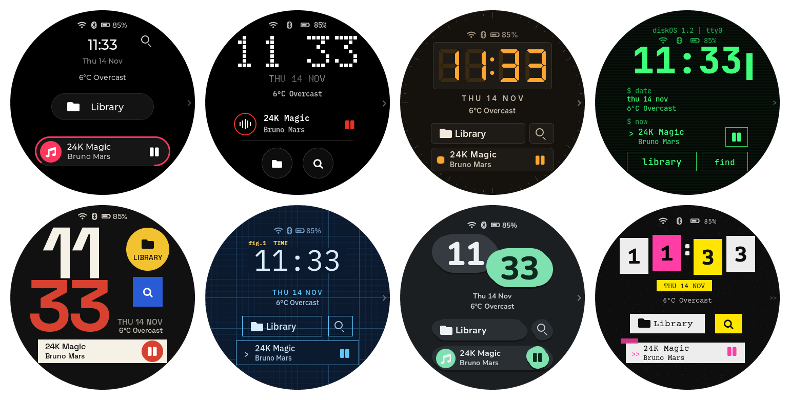

<p align="center">
  
</p>

<h1 align="center">
  <picture>
    <source media="(prefers-color-scheme: dark)" srcset="docs/assets/diskos-wordmark-light.svg">
    
  </picture>
</h1>

<p align="center">
  A round-screen music interface for the FiiO Snowsky Disc, built on its stock audio engine.
</p>

<p align="center">
  <a href="docs/INSTALL.md#host-support"></a>
  <a href="LICENSE"></a>
  <a href="ui/COPYING"></a>
  <a href="https://ko-fi.com/b0hemia"></a>
</p>

<p align="center">
  <a href="https://b0hemia.github.io/diskos/">Website</a> |
  <a href="#see-diskos">Screenshots</a> |
  <a href="#before-you-install">Before you install</a> |
  <a href="#install">Install</a> |
  <a href="#update-restore-recover">Restore</a> |
  <a href="#documentation">Docs</a> |
  <a href="#contributing">Contribute</a>
</p>

> [!IMPORTANT]
> **Installing replaces the Disc's system software.** Stored data and the SD card are left as they are.
> Keep the USB cable connected and the computer awake until the flash finishes, and keep a copy of the saved stock image.
> If a flash is interrupted, the Disc may need [mask-ROM recovery](docs/INSTALL.md#restore-stock-and-recover).

## At a glance

- **Device:** FiiO Snowsky Disc.
- **Release described here:** diskOS and installer 1.2.2-custom (based on upstream 1.2.1); beta.
- **Stock firmware supported:** V2.09, V2.28, V2.40, and V2.57.
- **Hosts:** Linux x86-64 (Debian, Ubuntu, Arch, CachyOS, Fedora); macOS Apple Silicon release package. Intel Macs can build the native tools. Windows 10/11 x64 release ZIP.
- **Flash time:** about 20 minutes, including the firmware check and verification.
- **Going back:** restore the saved stock image, boot the stock UI once, or set stock as the default UI.

## See diskOS

<table>
<tr>
<td align="center"><br><sub>Now Playing</sub></td>
<td align="center"><br><sub>Up Next</sub></td>
<td align="center"><br><sub>Timed lyrics</sub></td>
</tr>
<tr>
<td align="center"><br><sub>Song Info</sub></td>
<td align="center"><br><sub>Album cover flow</sub></td>
<td align="center"><br><sub>Search and keyboard</sub></td>
</tr>
</table>

**[See every screen in the diskOS tour](docs/TOUR.md).**

## Built around the Disc

### For listening

- [Now Playing](docs/TOUR.md#now-playing) puts music controls on the round display.
- Ogg Opus files (.opus, .oga, and .ogg) are indexed with tags and available lengths
  and played through the stock player.
- Home's now-playing border shows playback progress in the halo theme.
- [Up Next](docs/TOUR.md#up-next) shows the player's queue and lets you jump within it.
- [Lyrics and Song Info](docs/TOUR.md#song-info-and-lyrics) show words and available file details.
- [Library and cover flow](docs/TOUR.md#library) offer several ways to browse indexed music.
- [Playlists, favourites, and books](docs/TOUR.md#playlists) keep different listening collections close.
- [Themes and display choices](docs/TOUR.md#eight-themes) change the look of the interface.

### For tinkering

- [Display settings](docs/TOUR.md#settings-display) let you change theme, type size, and artwork behavior.
- [Quick Settings](docs/TOUR.md#quick-settings) lets you choose the controls in the pull-down drawer.
- [System settings](docs/TOUR.md#settings-system) include Debug Mode for temporary SSH access and Old tags
  (Auto by default / Western / Cyrillic); use Rescan Library after changing legacy tag or CUE-sheet decoding.
- [Updates and startup](docs/TOUR.md#updates-startup-and-power) explain keyed app updates and boot behavior.
- [Stock UI choices](docs/TOUR.md#safety-and-stock-ui) give you an interface fallback; [restore](docs/INSTALL.md#restore-stock-and-recover) removes the diskOS image.

## Before you install

You need a FiiO Snowsky Disc, its matching unmodified official FiiO firmware ZIP, a reliable
USB cable and about 20 uninterrupted minutes. Linux and macOS need Python 3.8 or newer;
the Windows release ZIP includes its runtime and tools. The installer builds the
root filesystem image on your computer; this project does not distribute FiiO's root filesystem.
Back up your music, keep a separate copy of the saved stock image, and read the [full requirements](docs/INSTALL.md#requirements).

For 1.2.0 users, see [Update, restore, recover](#update-restore-recover) for the signed app
update and fixes that require a **full flash** with the complete 1.2.1 installer.
The installer checks the selected firmware and the Disc before it writes.
If it refuses a firmware archive, use a matching unmodified official ZIP.
Read the on-screen message before retrying a failed flash.

## Install

### Linux and macOS

Run setup from the extracted release package, then start the graphical installer:

```sh
./install.sh
./diskos-installer gui
```

Select the official firmware ZIP and normally choose **Public**; **Dev** is under **Advanced**.
Power off the Disc, hold **Volume Down**, and connect USB to enter flash (mask-ROM) mode;
the screen stays black. The Ready checklist shows items needing attention and flash-mode help;
USB access is checked before flashing. Select **Install diskOS...**, then tick
**I understand and will keep the USB cable connected until it finishes.** on the confirmation
screen and select **Begin flash (~20 min)**. Keep the computer awake and
wait for verification before power-cycling the Disc. The Public variant has no always-on root shell;
Debug Mode can enable temporary SSH on the Disc.

For the command line, the equivalent install is:

```sh
./diskos-installer install --firmware SNOWSKY_DISC_update_*.zip --variant public
```

Read the [installation guide](docs/INSTALL.md) for OS packages, USB permissions, source checkouts,
options for your own build, and error codes. Do not run the installer with `sudo`.

### Windows

Use **Windows 10/11 x64**:

1. Extract the complete **diskos-installer-windows-x86_64.zip** from the 1.2.1 release.
   Open **diskos-installer.exe**; keep `_internal`, **RECOVERY.txt**, and all files together.
   The program is not code-signed. Windows SmartScreen may show "Windows protected your PC"
   on first run; if it does, select **More info**, then **Run anyway**.
2. Power off the Disc, hold **Volume Down**, and connect USB; the screen stays black.
3. If the Ready checklist offers **Set up USB driver...**, select it, confirm WinUSB
   setup, and approve the administrator prompt. A ready WinUSB driver needs no setup.
   If Windows requests a restart, restart and check again.
4. Select your matching official firmware ZIP and **Public**, then **Install diskOS...**.
   Tick the acknowledgement and select **Begin flash (~20 min)**; keep the computer
   awake and cable connected until verification succeeds, then power-cycle the Disc.
   During flashing, Windows may show an empty console window for the flash tool.
   Leave it open; closing it interrupts the host flash tool, and the Disc may keep writing.

Terminal commands use `diskos-installer-cli.exe`. See the [Windows guide](docs/INSTALL.md#windows)
and [RECOVERY.txt](RECOVERY.txt) for errors and recovery.

## Update, restore, recover

From 1.2.0, Settings > System > Update diskOS can install the signed 1.2.1 app update
over Wi-Fi if updates are allowed. Fresh installs and older versions use the installer.
It updates only the diskOS app, not stock firmware or the whole image, and does not change
how old a saved app update the system image allows. A fresh install or full flash with the
complete 1.2.1 installer stops saved app updates older than that limit taking over at boot.
The shutdown fix and the additional boot-script update fixes also require a full flash;
see the [release notes](docs/RELEASE_NOTES_1.2.1.md).
The 1.2.1 release image includes the diskOS release key by default. Turn updates off
on the Disc, or untick **Allow diskOS updates over Wi-Fi** when flashing. See [upgrading](docs/INSTALL.md#upgrading-to-121).

To use the stock interface without reflashing, set **Settings > System > Default UI > Stock**.
Holding **Volume Up** from power-on boots the other interface once: Stock when diskOS is the
default, or diskOS when Stock is the default. To remove the diskOS image, select
**Restore stock firmware...** in the installer, or run `restore-stock`. It uses the saved stock
image and offers a firmware ZIP picker only when no saved image is found. A damaged saved backup
may require `restore-stock --firmware`; see the guide below. A failed flash may need
mask-ROM reflashing. Read [restore and recovery](docs/INSTALL.md#restore-stock-and-recover)
before you need it.

### Any host: unknown or timed-out flash result

If flashing may have started and the result is unknown, **leave the Disc powered and
connected for at least 25 minutes after the error**. Keep the computer awake; do not retry
or disconnect during this wait. Follow [RECOVERY.txt](RECOVERY.txt), also included in the
Windows ZIP, for the full recovery steps, saved backup locations, and error codes.

## Current limitations

Last.fm remains Beta. In 1.2.1+, Wi-Fi skips the extra startup wait on V2.57 when Bluetooth is
saved off; other startup cases can still take about a minute. If no IP appears, reconnect in
Settings > Network > Wi-Fi. On the first boot after installing, a "Player didn't respond" message may
appear once; it is harmless.
An indexed file format may still fail to play on the Disc.
Some mono FLAC, MP3, and Opus files can play slowed down in the stock player. Now Playing
may still retain the old track after a mono Opus file advances into another mono Opus file.
The stock player and connected headphones also affect some audio and Bluetooth choices.
Browse Files supports folder-scoped queues and folder shuffle play. On V2.09,
playlist and book playback may fail; on V2.57, the Custom EQ editor is view-only.
Read the [tour's limits](docs/TOUR.md#limits) and [privacy disclosure](docs/PRIVACY.md).
This project is not affiliated with or endorsed by FiiO, Snowsky, or Ingenic.

## How it works

diskOS replaces the stock interface while keeping the stock player and audio engine.
The installer extracts your official FiiO firmware locally, saves a stock image for restore,
and adds diskOS to a new root filesystem image. It flashes that image over the Disc's mask-ROM
USB mode and verifies the written blocks. A boot hook starts the diskOS UI; the stock UI remains
available as a fallback. See the [hardware notes](docs/HARDWARE.md) for the device layout.

## Documentation

Start with the [documentation index](docs/README.md) for installation, the screen-by-screen tour,
development notes, hardware research, privacy, and license information.

## Contributing

Bug reports, hardware findings, documentation fixes, and focused patches are welcome.
Read [CONTRIBUTING.md](CONTRIBUTING.md) before changing flashing or security-sensitive code.
Report vulnerabilities privately through [SECURITY.md](SECURITY.md).

## License and support

The installer, scripts, and documentation are MIT licensed; see [LICENSE](LICENSE).
The on-device UI source in [ui/](ui/) is GPL-3.0-or-later; see [ui/COPYING](ui/COPYING).
The website HTML, CSS, JavaScript, and diskOS-owned screenshot images in [site/](site/)
are MIT licensed under [LICENSE](LICENSE). This grant covers only rights held by diskOS
contributors; third-party artwork and trademarks remain with their respective owners.
Website fonts retain their own licences; see [licenses/README.md](licenses/README.md#website-fonts).
Third-party license details and corresponding source are listed in [NOTICE.md](NOTICE.md),
[SPL_SOURCE.md](SPL_SOURCE.md), and [licenses/](licenses/).

DiskOS is an open-source hobby project maintained by b0hemia, with community contributions.
Tips are optional, but they help keep testing, reverse-engineering, documentation, and release
work moving.

<p align="center">
  <a href="https://ko-fi.com/b0hemia">
    
  </a>
</p>

> [!WARNING]
> Do not redistribute generated `diskos_*.bin` images. They contain FiiO's root filesystem.
> Build them locally from firmware you obtained from FiiO and share the installer instead.
