<p align="center">
  
</p>

<h1 align="center">
  <picture>
    <source media="(prefers-color-scheme: dark)" srcset="docs/assets/diskos-wordmark-light.svg">
    
  </picture>
</h1>

<p align="center">
  A round-screen music interface for the FiiO Snowsky Disc, with local playback through its stock audio engine.
</p>

<p align="center">
  <a href="docs/INSTALL.md#host-support"></a>
  <a href="LICENSE"></a>
  <a href="ui/COPYING"></a>
  <a href="https://ko-fi.com/b0hemia"></a>
</p>

<p align="center">
  <a href="https://b0hemia.github.io/diskos/">Website</a> |
  <a href="#see-diskos">Screenshots</a> |
  <a href="#before-you-install">Before you install</a> |
  <a href="#install">Install</a> |
  <a href="#update-restore-recover">Restore</a> |
  <a href="#documentation">Docs</a> |
  <a href="#contributing">Contribute</a>
</p>

> [!IMPORTANT]
> **Installing replaces the Disc's system software.** Stored data and the SD card are left as they are.
> Keep the USB cable connected and the computer awake until the flash finishes, and keep a copy of the saved stock image.
> If a flash is interrupted, the Disc may need [mask-ROM recovery](docs/INSTALL.md#restore-stock-and-recover).

## At a glance

- **Device:** FiiO Snowsky Disc.
- **Release described here:** diskOS and installer 1.5-custom (based on upstream 1.2.2); beta.
- **Stock firmware supported:** V2.09, V2.28, V2.40, and V2.57. AirPlay receiving needs V2.40 or V2.57.
- **Hosts:** Linux x86-64 (Debian, Ubuntu, Arch, CachyOS, Fedora); macOS Apple Silicon release package. Intel Macs can build the native tools. Windows 10/11 x64 release ZIP.
- **Flash time:** about 20 minutes, including the firmware check and verification.
- **Going back:** restore the saved stock image, boot the stock UI once, or set stock as the default UI.

## Custom Fork Enhancements (v1.5-custom vs. Upstream 1.2.2)

This fork is rebased onto upstream **v1.2.2** and combines all upstream Beam (Cast/AirPlay), AirPlay Receiving, and device names features with our custom stability, power, audio, and performance enhancements:

- **Upstream v1.2.2 Features Integrated**:
  - **Beam to Cast and AirPlay**: Send music from the Disc's card to Google Cast devices and Apple AirPlay speakers and TVs. The Disc's display and controls serve as the remote.
  - **AirPlay Receiving**: Use the Disc as a Wi-Fi AirPlay speaker from an iPhone, iPad, or Mac with synchronized volume and metadata display.
  - **Device Names**: Rename the Disc for network display and Bluetooth pairing, with per-device Bluetooth nicknames.
  - **Custom Image Screensavers**: Load custom full-screen artwork from `CustomCover/` on the SD card with interactive preview.
  - **Modernized Audio Restoration**: Reconnect state machine with generation-tracked asynchronous audio restoration (`ui_reapply_audio` / `audio_restore_tick`).

- **Harmonized Settings Hierarchy**:
  - **Web Server**: Under **Settings > Network > Web Server** (also accessible from the Apps tile).
  - **Battery Usage History**: Under **Settings > Battery & Power > Usage History** (also in Apps and Quick Settings).
  - **Touch to Wake**: Under **Settings > Display > Touch to Wake**.
  - **Shut down**: Under **Settings > Device > Shut down** with safety confirmation modal.

- **Preserved diskOS Custom Capabilities**:
  - **Graceful Shutdown Animation & Safe Power-Off**: Reverse boot splash animation on `lv_layer_top` (contracting disc, warming hub, Archivo wordmark, orbiting spectra during storage flush/sync, and dissolve to solid black with display backlight rail cut); hardware power button long-press (3-5s) safe shutdown listener via `x2000_key` and stock `aa03` (`POWER_KEY_EVENT_REPORT`) IPC frames; user-facing "Shut down" action under Settings > Device.
  - **Web UI & Remote Control**: Embedded HTTP/WebSocket server (`diskos-webd`) on port 8080 providing browser-based remote playback control, real-time volume/seek, queue jump, MicroSD file browsing, track selection, folder creation, and direct music uploads over Wi-Fi, with seamless on-device management under Apps > Web Server and zero-reflash MicroSD installation. See **[Web UI documentation](docs/WEBUI.md)**.
  - **Startup Splash & Player Readiness**: Polished boot splash with looping light orbit phase until `mq_player` is ready, with 12s backstop; transport commands and queue jumps guarded by readiness checks; in-process SQLite `WORK_MODE` reset replacing forked subprocesses.
  - **Navigation & Drawer Ergonomics**: Isolated Quick Settings from back-stack history returning cleanly to the active screen; interactive drawer drag; auto-scrollbars and scroller getters for all scrollable screens; touch-theft guards for non-overflowing lists, hidden search results, and Library A-Z grid.
  - **Hardware Sleep & Wake Stability**: Resolves screen-off false wake loop and touch freeze on timed auto-sleep; synchronizes `mq_player` power state via Linux evdev (`KEY_POWER`) injection for reliable single-press physical power button wake; implements stock CST816T deep sleep sequencing (0mA) with optional "Touch to Wake" toggle under Settings > Display.
  - **Battery & Power Management**: Real-time battery ADC fuel gauge tracking (`voltage_now`); automated critical low-battery shutdown; interactive 24-hour circular usage dial (`SCR_USAGE`) in Apps; Quick Settings live clock and direct battery shortcut.
  - **External USB DAC Host Mode (Mode 4)**: USB Audio output to external USB DACs over USB-C OTG (V2.40/V2.57) with hotplug netlink uevent handling and disconnect queue-burn protection.
  - **Mode Lockdown Screens (`SCR_MODELOCK`)**: Full-screen dedicated status interfaces for USB DAC, Bluetooth Receiver (with AVRCP transport controls and synchronized volume), and USB Storage, with safe edge-swipe navigation.
  - **Audio & Bluetooth Refinements**: Hierarchical Bluetooth codec fallback (`LDAC` -> `AAC` -> `SBC`); live active codec badge on Song Info; BlueALSA subprocess hardening.
  - **UI Performance & Ergonomics**: 14-slot row virtualization in library lists eliminating scrolling stutter on large libraries; folder-scoped playback and shuffle; fast-scroll A-Z index popup; expanded Japanese Kanji/Kana CJK font support (3,724 glyphs).

Read the **[v1.5-custom release notes](docs/RELEASE_NOTES_1.5_CUSTOM.md)** for detailed technical descriptions and diffs.

## See diskOS

<table>
<tr>
<td align="center">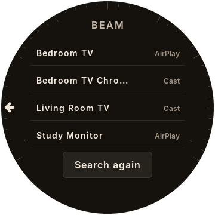<br><sub>Beam to a speaker or TV</sub></td>
<td align="center">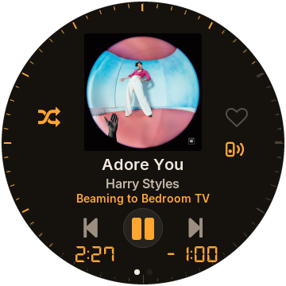<br><sub>Now Playing while beaming</sub></td>
<td align="center">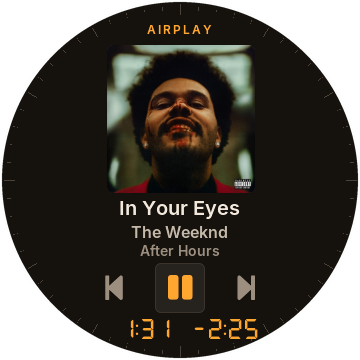<br><sub>AirPlay Receiving</sub></td>
</tr>
<tr>
<td align="center"><br><sub>Timed lyrics</sub></td>
<td align="center"><br><sub>Album cover flow</sub></td>
<td align="center"><br><sub>Search and keyboard</sub></td>
</tr>
<tr>
<td align="center">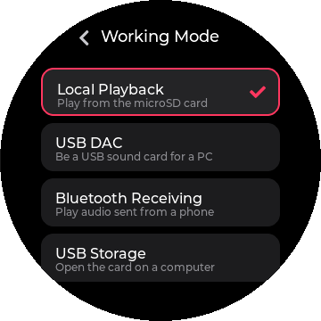<br><sub>Working Mode</sub></td>
<td align="center"><br><sub>Screensaver</sub></td>
</tr>
<tr>
<td align="center">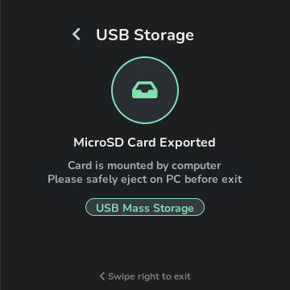<br><sub>Mode Lockdown USB Storage</sub></td>
<td align="center">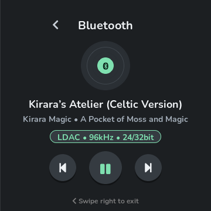<br><sub>Mode Lockdown Bluetooth Receiver</sub></td>
<td align="center">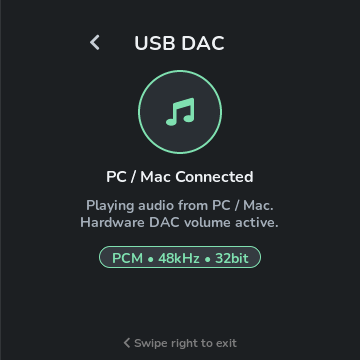<br><sub>Mode Lockdown USB DAC</sub></td>
</tr>
</table>

### Web UI & Remote Control (Browser SPA)

Control playback, browse tracks, and manage your MicroSD card wirelessly from any browser over local Wi-Fi:

<table>
<tr>
<td align="center" valign="top" width="20%">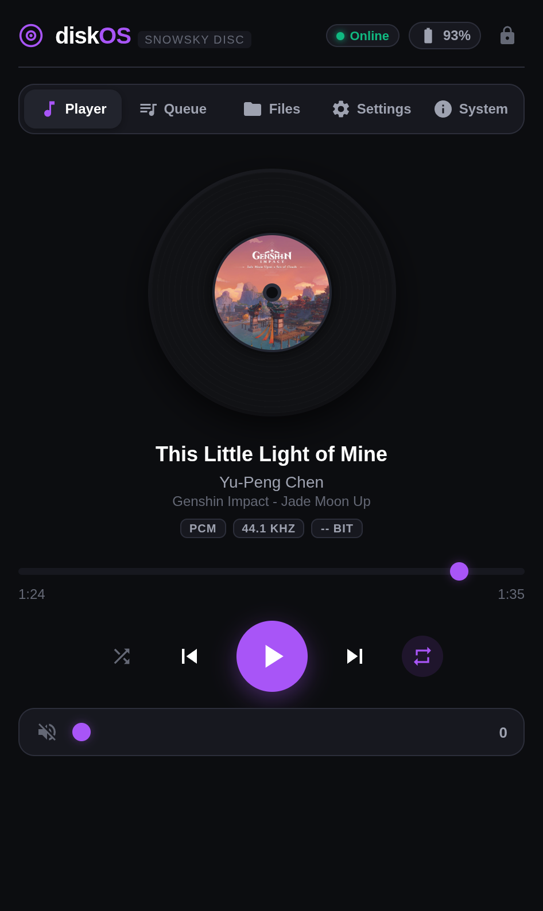<br><sub>Player & Turntable</sub></td>
<td align="center" valign="top" width="20%">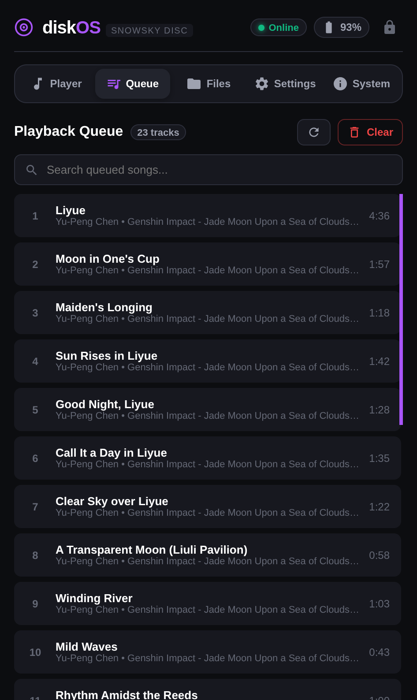<br><sub>Queue & Track Jump</sub></td>
<td align="center" valign="top" width="20%">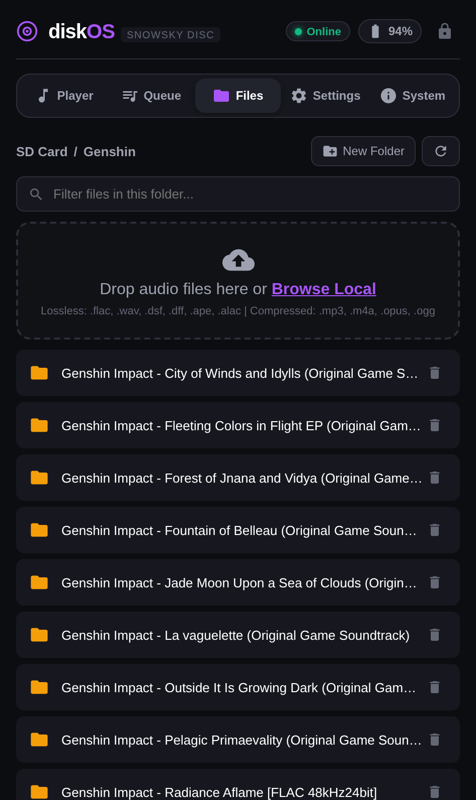<br><sub>File Manager & Upload</sub></td>
<td align="center" valign="top" width="20%">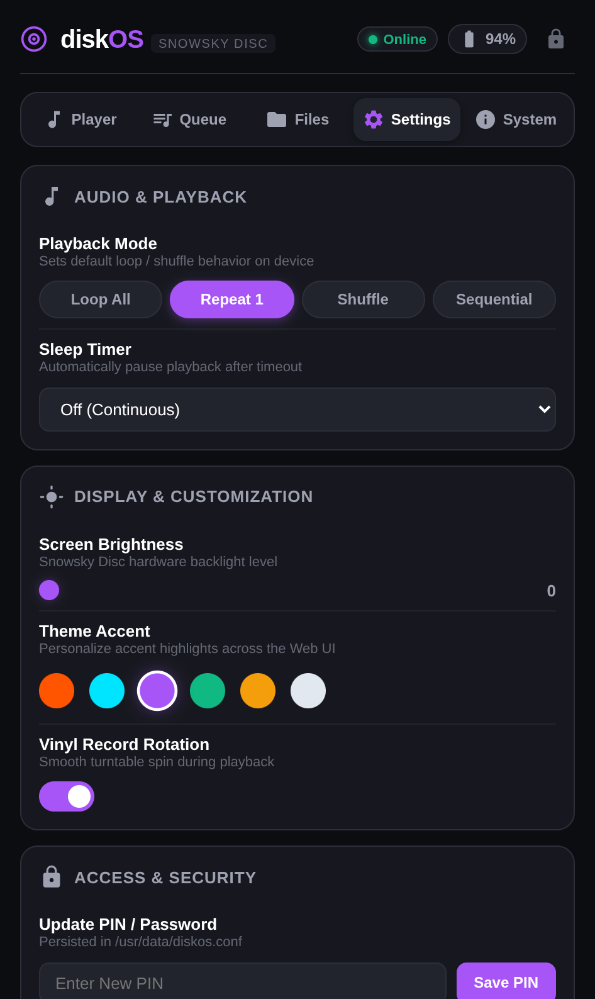<br><sub>Audio & Device Settings</sub></td>
<td align="center" valign="top" width="20%">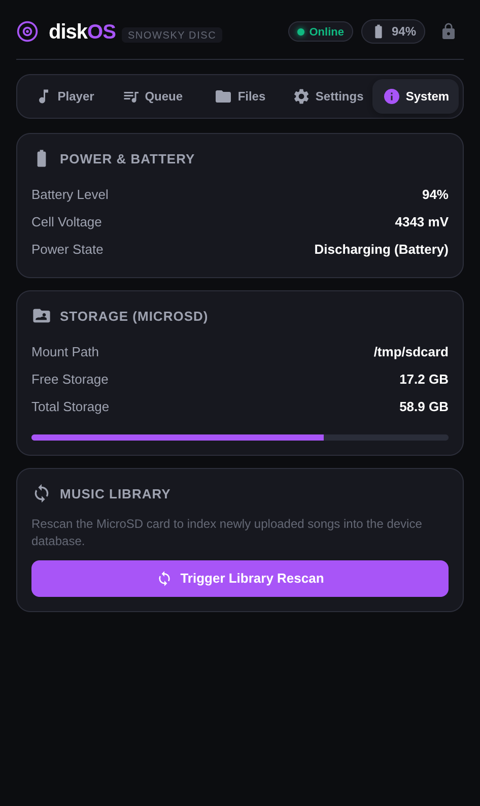<br><sub>System & Storage Metrics</sub></td>
</tr>
</table>

**[See every screen in the diskOS tour](docs/TOUR.md).**

## Built around the Disc

### For listening

- [Now Playing](docs/TOUR.md#now-playing) puts music controls on the round display.
- Ogg Opus files (.opus, .oga, and .ogg) are indexed with tags and available lengths
  and played through the stock player.
- Home's now-playing border shows playback progress in the halo theme.
- Beam plays the Disc's music on Cast and AirPlay speakers and TVs on your Wi-Fi, from the
  Beam button on Now Playing, the Options page or an optional Quick Settings tile.
  Playback controls, volume keys and the volume dial control the receiver. If Beam
  cannot start, the reason stays on screen with guidance for trying again.
- AirPlay Receiving (V2.40 and V2.57) lets an iPhone or Mac play to the Disc; pick it as a source.
- [Up Next](docs/TOUR.md#up-next) shows the player's queue and lets you jump within it.
- [Lyrics and Song Info](docs/TOUR.md#song-info-and-lyrics) show words and available file details.
- [Library and cover flow](docs/TOUR.md#library) offer several ways to browse indexed music.
- [Playlists, favourites, and books](docs/TOUR.md#playlists) keep different listening collections close.
- [Mode Lockdown](docs/TOUR.md#settings-audio-and-working-mode) provides dedicated full-screen status and transport hubs for Bluetooth Receiving (with phone AVRCP controls), USB DAC slave mode (with sample-rate badges), and USB Storage with safe edge-swipe navigation.
- [Themes and display choices](docs/TOUR.md#eight-themes) change the look of the interface.
- [Apps and Web Server](docs/TOUR.md#apps-lastfm-and-weather) include Web Server for browser remote control and Wi-Fi file uploads, 24-hour battery tracking, and Last.fm scrobbling.

### For tinkering

- [Display settings](docs/TOUR.md#settings-display) let you change theme and type size.
- [Quick Settings](docs/TOUR.md#quick-settings) lets you choose the controls in the pull-down drawer.
- [Device settings](docs/TOUR.md#settings-device) include Debug Mode for temporary SSH access.
- [Library settings](docs/TOUR.md#settings-library) include Tag Encoding
  (Auto by default / Western / Cyrillic); use Rescan Library after changing legacy tag or CUE-sheet decoding.
- [Screensaver](docs/TOUR.md#screensaver-and-screen-off) can show your own JPG, PNG, BMP or
  animated GIF from the CustomCover folder on the SD card, with optional time, date, battery,
  now-playing and weather overlays.
- [Network settings](docs/TOUR.md#settings-network) can rename the Disc and its Bluetooth name,
  and give paired devices nicknames. The Disc's network name needs a full flash of 1.2.2.
- Settings > Device > Automatic Update Checks (off by default) announces new releases; it never
  installs anything without your tap.
- Swipe up from the bottom edge of the screen to go straight Home.
- [Updates and startup](docs/TOUR.md#updates-startup-and-power) explain keyed app updates and boot behavior.
- [Stock UI choices](docs/TOUR.md#safety-and-stock-ui) give you an interface fallback; [restore](docs/INSTALL.md#restore-stock-and-recover) removes the diskOS image.

## Before you install

You need a FiiO Snowsky Disc, a reliable USB cable and about 20 uninterrupted minutes for flashing.
Choose the firmware version already on your Disc and press **Get firmware**; the installer downloads
and verifies the matching official FiiO ZIP and fills in its path. A saved verified copy or
**Browse...** lets you prepare offline. Linux and source checkouts need Python 3.8 or newer;
the macOS app and Windows release ZIP include their runtime and tools. The installer builds the
root filesystem image on your computer; this project does not distribute FiiO's root filesystem.
Back up your music, keep a separate copy of the saved stock image, and read the [full requirements](docs/INSTALL.md#requirements).

For 1.2.1 users, see [Update, restore, recover](#update-restore-recover) for the signed app
update and changes that require a **full flash** with the complete 1.2.2 installer.
The installer checks the selected firmware and the Disc before it writes.
If it refuses a firmware archive, use a matching unmodified official ZIP.
Read the on-screen message before retrying a failed flash.

## Install

Reinstalling starts the diskOS version included in this installer and clears
downloaded diskOS updates. Your settings and music are kept.

### macOS

Download the Apple Silicon release archive, extract it and open **diskOS Installer.app**.
No Python, Homebrew or extra libraries are needed. Follow the [macOS steps](docs/INSTALL.md#macos)
for first-run Gatekeeper approval, mask-ROM mode and flashing.

### Linux and source checkouts

Run setup from the extracted release package, then start the graphical installer:

```sh
./install.sh
./diskos-installer gui
```

Under **Which firmware is on your Disc?**, select its version, then press **Get firmware**.
Wait for the verified message and filled path, then normally choose **Public**; **Dev** is under **Advanced**.
**Browse...** accepts a matching official ZIP you already have. See [Get firmware](docs/INSTALL.md#get-firmware)
and the [privacy disclosure](docs/PRIVACY.md#the-installer-this-repo).
Power off the Disc, hold **Volume Down**, and connect USB to enter flash (mask-ROM) mode;
the screen stays black. The Ready checklist shows items needing attention and flash-mode help;
USB access is checked before flashing. Select **Install diskOS...**, then tick
**I understand and will keep the USB cable connected until it finishes.** on the confirmation
screen and select **Begin flash (~20 min)**. Keep the computer awake and
wait for verification before power-cycling the Disc. The Public variant has no always-on root shell;
Debug Mode can enable temporary SSH on the Disc.

For the command line, the equivalent install is:

```sh
./diskos-installer install --firmware SNOWSKY_DISC_update_*.zip --variant public
```

Read the [installation guide](docs/INSTALL.md) for OS packages, USB permissions, source checkouts,
options for your own build, and error codes. Do not run the installer with `sudo`.

### Windows

Use **Windows 10/11 x64**:

1. Extract the complete **diskos-installer-windows-x86_64.zip** from the 1.2.2 release.
   Open **diskos-installer.exe**; keep `_internal`, **RECOVERY.txt**, and all files together.
   The program is not code-signed. Windows SmartScreen may show "Windows protected your PC"
   on first run; if it does, select **More info**, then **Run anyway**.
2. Read the firmware version on the Disc, then power it off. Hold **Volume Down** and
   connect USB; the screen stays black.
3. If the Ready checklist offers **Set up USB driver...**, select it, confirm WinUSB
   setup, and approve the administrator prompt. A ready WinUSB driver needs no setup.
   If Windows requests a restart, restart and check again.
4. Select the firmware version already on your Disc and press **Get firmware** (or **Browse...**
   for a matching ZIP). Once verified, choose **Public**, then **Install diskOS...**.
   Tick the acknowledgement and select **Begin flash (~20 min)**; keep the computer
   awake and cable connected until verification succeeds, then power-cycle the Disc.
   During flashing, Windows may show an empty console window for the flash tool.
   Leave it open; closing it interrupts the host flash tool, and the Disc may keep writing.

Terminal commands use `diskos-installer-cli.exe`. See the [Windows guide](docs/INSTALL.md#windows)
and [RECOVERY.txt](RECOVERY.txt) for errors and recovery.

## Update, restore, recover

From 1.2.1, Settings > System > Update diskOS can install the signed 1.2.2 app update
over Wi-Fi if updates are allowed. Fresh installs and older versions use the installer.
It updates only the diskOS app, not stock firmware or the whole image, and does not change
how old a saved app update the system image allows. A full flash with the complete 1.2.2
installer starts the diskOS version inside that installer and clears downloaded diskOS updates;
settings and music are kept. The network name hook, the per-flash identity and the boot-script
update-retention fix also require a full flash;
see the [release notes](docs/RELEASE_NOTES_1.2.2.md).
The 1.2.2 release image includes the diskOS release key by default. Turn updates off
on the Disc, or untick **Allow diskOS updates over Wi-Fi** when flashing. See [upgrading](docs/INSTALL.md#upgrading-to-122).

To use the stock interface without reflashing, set **Settings > Device > Default UI > Stock**.
Holding **Volume Up** from power-on boots the other interface once: Stock when diskOS is the
default, or diskOS when Stock is the default. To remove the diskOS image, select
**Restore stock firmware...** in the installer, or run `restore-stock`. It uses the saved stock
image after validating it. If it is missing or unusable, the GUI offers the same version dropdown,
**Get firmware** and **Browse...** flow to rebuild stock firmware. The command line accepts
`restore-stock --firmware` for rebuilding from a local ZIP. A failed flash may need
mask-ROM reflashing. Read [restore and recovery](docs/INSTALL.md#restore-stock-and-recover)
before you need it.

### Any host: unknown or timed-out flash result

If flashing may have started and the result is unknown, **leave the Disc powered and
connected for at least 25 minutes after the error**. Keep the computer awake; do not retry
or disconnect during this wait. Follow [RECOVERY.txt](RECOVERY.txt), also included in the
Windows ZIP, for the full recovery steps, saved backup locations, and error codes.

## Current limitations

Last.fm remains Beta. Wi-Fi skips the extra startup wait on V2.57 when Bluetooth is
saved off; other startup cases can still take about a minute. If no IP appears, reconnect in
Settings > Network > Wi-Fi.
An indexed file format may still fail to play on the Disc.
Some mono FLAC, MP3, and Opus files can play slowed down in the stock player. Now Playing
may still retain the old track after a mono Opus file advances into another mono Opus file.
The stock player and connected headphones also affect some audio and Bluetooth choices.
Browse Files supports folder-scoped queues and folder shuffle play. On V2.09,
playlist and book playback may fail; on V2.57, the Custom EQ editor is view-only.
Beam to Cast supports MP3, AAC, Opus, Ogg Vorbis, and 16- or 24-bit FLAC and PCM WAV up to 96
kHz, in mono or stereo. Google Home Mini receivers accept FLAC up to 48 kHz. AirPlay decodes
mono or stereo MP3, FLAC and PCM WAV at 8-384 kHz and converts AAC, ALAC, Opus, Ogg Vorbis, WMA,
APE and DSD. Unsupported files, CUE tracks and audiobooks cannot be beamed. See the [Beam
guide](docs/TOUR.md#beam) for controls and limits. Hebrew letters show, but right-to-left
ordering is not corrected.
Read the [tour's limits](docs/TOUR.md#limits) and [privacy disclosure](docs/PRIVACY.md).
This project is not affiliated with or endorsed by FiiO, Snowsky, or Ingenic.

## How it works

diskOS replaces the stock interface while keeping the stock player and audio engine for local playback. Beam plays through the selected receiver.
The installer extracts your official FiiO firmware locally, saves a stock image for restore,
and adds diskOS to a new root filesystem image. It flashes that image over the Disc's mask-ROM
USB mode and verifies the written blocks. A boot hook starts the diskOS UI; the stock UI remains
available as a fallback. See the [hardware notes](docs/HARDWARE.md) for the device layout.

## Documentation

Start with the [documentation index](docs/README.md) for installation, the screen-by-screen tour,
development notes, hardware research, privacy, and license information.

## Contributing

Bug reports, hardware findings, documentation fixes, and focused patches are welcome.
Read [CONTRIBUTING.md](CONTRIBUTING.md) before changing flashing or security-sensitive code.
Report vulnerabilities privately through [SECURITY.md](SECURITY.md).

## License and support

The installer, scripts, and documentation are MIT licensed; see [LICENSE](LICENSE).
The on-device UI source in [ui/](ui/) is GPL-3.0-or-later; see [ui/COPYING](ui/COPYING).
The website HTML, CSS, JavaScript, and diskOS-owned screenshot images in [site/](site/)
are MIT licensed under [LICENSE](LICENSE). This grant covers only rights held by diskOS
contributors; third-party artwork and trademarks remain with their respective owners.
Website fonts retain their own licences; see [licenses/README.md](licenses/README.md#website-fonts).
Third-party license details and corresponding source are listed in [NOTICE.md](NOTICE.md),
[SPL_SOURCE.md](SPL_SOURCE.md), and [licenses/](licenses/).

DiskOS is an open-source hobby project maintained by b0hemia, with community contributions.
Tips are optional, but they help keep testing, reverse-engineering, documentation, and release
work moving.

<p align="center">
  <a href="https://ko-fi.com/b0hemia">
    
  </a>
</p>

> [!WARNING]
> Do not redistribute generated `diskos_*.bin` images. They contain FiiO's root filesystem.
> Build them locally from firmware you obtained from FiiO and share the installer instead.
