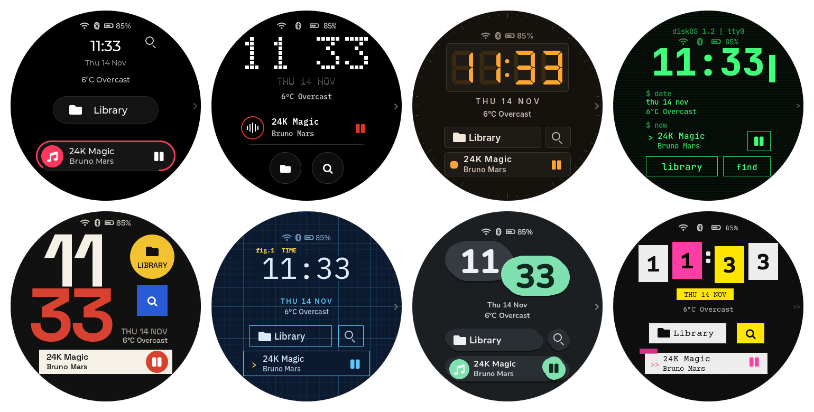
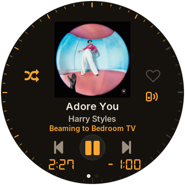
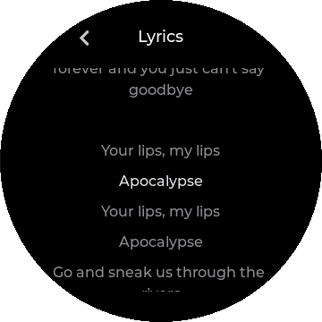
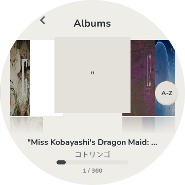
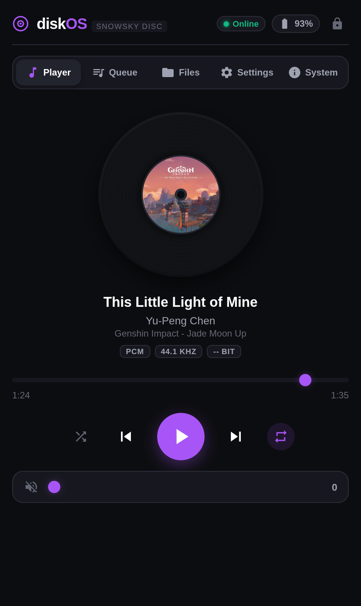
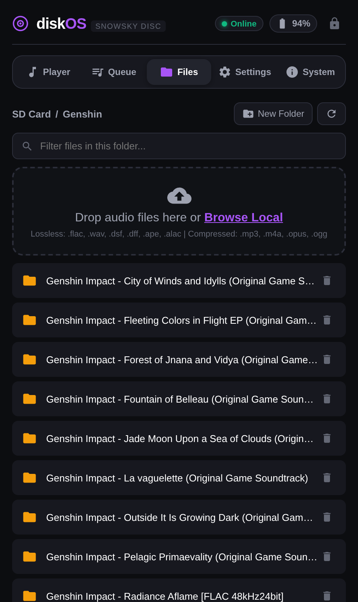

<div align="center">

<picture>
  <source media="(prefers-color-scheme: dark)" srcset="docs/assets/diskos-wordmark-light.svg">
  
</picture>

### A custom round-screen interface and firmware for the FiiO Snowsky Disc

[](docs/INSTALL.md#host-support)
[](docs/RELEASE_NOTES_1.6_CUSTOM.md)
[](docs/HARDWARE.md)
[](docs/INSTALL.md#requirements)
[](docs/README.md)
[](LICENSE)
[](ui/COPYING)

[Overview](#overview) • [Features](#features) • [Screenshots](#screenshots) • [Requirements](#requirements) • [Installation](#installation) • [How It Works](#how-it-works) • [Web UI](#web-ui-remote-control) • [Troubleshooting](#troubleshooting-recovery) • [Documentation](#documentation)

<br>



</div>

## Overview

**diskOS** is a custom user interface and firmware patch engineered specifically for the **FiiO Snowsky Disc** (Ingenic X2000 MIPS SoC). This repository is a customized fork maintained at [IniGisah/diskos](https://github.com/IniGisah/diskos) (rebased on upstream [b0hemia/diskos](https://github.com/b0hemia/diskos) v1.2.2). It replaces the stock interface with a bespoke, themeable UI tailored to the player's 360×360 circular display, while retaining FiiO's low-level audio engine, hardware decoders, and quad-DAC routing for bit-perfect local playback.

The installer builds the system image locally on your host computer using an official FiiO firmware archive. It preserves existing music files and user data on the MicroSD card, retains dual-boot access to the stock interface, and incorporates hardware-level recovery protections.

> [!IMPORTANT]
> **Non-destructive flashing**: Flashing rewrites the read-only root filesystem partition (`mtd2`). Music and files stored on your MicroSD card and the persistent data partition (`mtd7`) remain untouched. The boot process is fail-closed, allows instant dual-booting into the stock UI via hardware buttons, and uses the Ingenic mask-ROM USB mode as a recovery safety net.

## Features

- **Bespoke Circular UI** — Native 360×360 round-screen interface built on LVGL 9, featuring 8 distinct themes (Bauhaus, Blueprint, Hi-Fi, Terminal, Stone, Zine, and more) with smooth 60 FPS transitions and edge-swipe gestures.
- **Track Artwork Thumbnails Across Song Lists** — Renders 36×36 album art thumbnails across Library Songs, Folder Browser, Playlist View, Search results, and Up Next lists, backed by an in-memory 128-entry cache and fast 42px BMP disk lookup (toggleable in Settings > Library > Browsing > Track Artwork).
- **Bit-Perfect Local Audio** — Retains FiiO's native audio daemon (`mq_player`) and kernel ioctl routing across all 4× Cirrus Logic CS43131 balanced DACs, supporting FLAC, DSD, WAV, MP3, AAC, and Ogg Opus.
- **Bluetooth Receiver Device Management & Live Codec Switching** — Smart paired devices modal sheet filtering transmitting audio hosts (phones, tablets, PCs) from audio sinks (headphones), live receiver codec picker dialog (LDAC, aptX-HD, aptX, AAC, SBC), Options Hub shortcuts, and auto-healing watchdog.
- **External USB DAC Host Audio Restored (Mode 4)** — Unblocked USB Audio Out routing to external USB DACs over USB-C OTG (V2.40/V2.57) with DWC2 host power sequencing.
- **Full Bluetooth Codec Suite** — High-resolution bidirectional Bluetooth supporting LDAC, aptX-HD, aptX, AAC, and SBC via a custom BlueALSA stack, plus a dedicated low-latency mode (~80–120ms) for video sync and mobile gaming.
- **Wireless Streaming with Beam** — Stream audio wirelessly from the Disc's MicroSD card to Google Cast devices and Apple AirPlay speakers or TVs over local Wi-Fi, using the player as a remote control.
- **AirPlay Receiving** — Turn the Disc into a wireless Hi-Fi AirPlay receiver from iOS, iPadOS, and macOS with synchronized volume and live metadata display (requires stock firmware V2.40 or V2.57).
- **Browser Remote Control & Web UI** — Built-in lightweight HTTP/WebSocket daemon (`diskos-webd`) on port 8080 for wireless playback control, queue jumping, volume management, and direct drag-and-drop MicroSD file uploads over Wi-Fi.
- **Dedicated Mode Lockdown** — Distraction-free full-screen dashboards for USB DAC Host Mode, Bluetooth Audio Sink (with phone AVRCP controls), and USB Mass Storage.
- **Power & Sleep Stability** — Real-time ADC fuel-gauge battery tracking, optional Touch-to-Wake (CST816T deep sleep at 0mA), zero-blink single-press power button wake, and multi-stage safe shutdown animation.
- **Modal Touch & Gesture Isolation** — Swallows edge back-swipes, rim wheel scrolling, and track scrubbing while modal dialogs or bottom sheets are open to eliminate accidental input bleed-through.
- **Circular Display Polish** — Header font step-down, tightened vertical descent, dialog minimum widths/padding, and inset quick settings layout to prevent bezel clipping on the round screen.
- **Dual-Boot Hardware Fallback** — Hold **Volume Up** during power-on to boot into the stock FiiO UI at any time without reflashing or altering settings.

## Screenshots

| Beam to Cast & AirPlay | Now Playing & Halo Ring | AirPlay Receiving |
|:---:|:---:|:---:|
| <br><sub>Stream to network speakers</sub> | <br><sub>Track controls & progress halo</sub> | <br><sub>Wireless Hi-Fi speaker mode</sub> |

| Timed Lyrics | Album Cover Flow | Mode Lockdown (BT Sink) |
|:---:|:---:|:---:|
| <br><sub>Synchronized LRC lyric view</sub> | <br><sub>Visual cover carousel</sub> | <br><sub>AVRCP phone controls & codec badge</sub> |

Explore every screen, theme, and setting in the **[Complete Interface Tour](docs/TOUR.md)**.

### Web UI & Remote Control

Control playback, browse tracks, and manage your MicroSD card wirelessly from any desktop or mobile browser over local Wi-Fi:

| Player & Turntable | Queue & Track Jump | Wireless File Manager | Device & Audio Settings |
|:---:|:---:|:---:|:---:|
| <br><sub>Live playback & volume</sub> | <br><sub>Instant queue jumping</sub> | <br><sub>MicroSD file upload & browse</sub> | <br><sub>Audio modes & sleep timers</sub> |

Read the **[Web UI & Remote Control Guide](docs/WEBUI.md)** for architecture details and REST/WebSocket API endpoints.

## Requirements

| Requirement | Details |
|---|---|
| **Target Device** | FiiO Snowsky Disc (Ingenic X2000 SoC) |
| **Supported Stock Firmware** | V2.09, V2.28, V2.40, V2.57 *(AirPlay Rx & USB Audio Out require V2.40 or V2.57)* |
| **Supported Host OS** | Linux x86-64 (Debian, Ubuntu, Arch, CachyOS, Fedora)<br>macOS (Apple Silicon prebuilt app; Intel builds from source)<br>Windows 10/11 x64 (standalone release ZIP) |
| **Host Runtime** | Python 3.8+ on Linux / source checkouts (bundled inside macOS and Windows releases) |
| **Hardware Connection** | Direct USB-C data cable (avoid unpowered hubs), ~20 uninterrupted minutes |

> [!NOTE]
> The installer does **not** redistribute FiiO's copyrighted root filesystem. It downloads or accepts the user's official FiiO firmware ZIP, unpacks it locally, patches the UI and boot hook, and flashes the resulting image.

## Installation

### Linux

1. Install system prerequisites and configure USB permissions:
   ```bash
   # Debian / Ubuntu:
   sudo apt install python3 python3-venv python3-tk libusb-1.0-0 squashfs-tools

   # Arch / CachyOS:
   sudo pacman -S python tk libusb squashfs-tools

   # Fedora:
   sudo dnf install python3 python3-tkinter libusb1 squashfs-tools
   ```

2. Clone or extract the release, install local udev rules, and run setup:
   ```bash
   sudo cp udev/70-diskos-maskrom.rules /etc/udev/rules.d/
   sudo udevadm control --reload-rules && sudo udevadm trigger

   ./install.sh
   ```

3. Launch the installer:
   ```bash
   ./diskos-installer gui
   ```
   *Or install via the command line:*
   ```bash
   ./diskos-installer install --firmware SNOWSKY_DISC_update_*.zip --variant public
   ```

> [!WARNING]
> Do **not** run `./diskos-installer` with `sudo`. Saved backup images and recovery state belong under your normal user account. The udev rule handles non-root USB access.

### macOS

1. Download `diskos-installer-macos-arm64.tar.gz` from the Releases page and extract it.
2. Drag **diskOS Installer.app** to your Applications folder. No Python, Homebrew, or extra libraries are required.
3. Open the app. If macOS Gatekeeper blocks it on first run, go to **System Settings > Privacy & Security > Open Anyway**.
4. Select the firmware version currently on your Disc, click **Get firmware**, and proceed with flashing.

### Windows

1. Extract `diskos-installer-windows-x86_64.zip`. Keep all files in the extracted directory intact.
2. Launch **diskos-installer.exe**. If Windows SmartScreen displays a warning, select **More info** > **Run anyway**.
3. If prompted by the Ready checklist, select **Set up USB driver...** to configure WinUSB for device `a108:eaef`.
4. Select the matching firmware version, click **Get firmware**, review the checklist, and start the flash.
   *(Command-line workflows use `diskos-installer-cli.exe`)*.

### Device Flashing Procedure

1. **Power off the Disc** completely.
2. **Hold Volume Down** and connect the USB-C cable to your computer. The screen remains black; the device is now in Ingenic mask-ROM mode (`a108:eaef`).
3. In the installer, select **Install diskOS...**, check the confirmation checkbox, and click **Begin flash (~20 min)**.
4. Keep the computer awake and the USB cable connected until verification finishes, then power-cycle the Disc.

> [!TIP]
> **Dual-Boot Fallback**: To boot the stock FiiO UI instead of diskOS, hold **Volume Up** while powering on the Disc. You can also configure the default startup system under **Settings > Device > Default UI**.

## How It Works

```
+-------------------------------------------------------------------------------+
|                            Host PC (Installer)                                |
|  Official FiiO ZIP  --->  Extract Rootfs  --->  Patch diskOS Hook & UI  --->  |
+-----------------------------------------------------------------------|-------+
                                                 Mask-ROM USB (a108:eaef)
                                                                        v
+-------------------------------------------------------------------------------+
|                       FiiO Snowsky Disc (Ingenic X2000)                       |
|                                                                               |
|  [ mtd0: U-Boot ]  --->  [ mtd1: Linux 4.4 Kernel ]                           |
|                                                                               |
|  [ mtd2: Rootfs (SquashFS, Read-Only) ]                                       |
|    |-- /etc/init.d/S97diskos_install (Fail-closed boot hook & manifest check) |
|    |-- /usr/bin/mq_player (Preserved stock audio decoder daemon)             |
|                                                                               |
|  [ mtd7: Data (UBIFS, Writable) - /usr/data ]                                 |
|    |-- /usr/data/bin/mq_ui (diskOS LVGL 9 Round UI)                           |
|    |-- /usr/data/bin/diskos-webd (Embedded HTTP/WebSocket Remote Server)      |
|    |-- /usr/data/etc/ (Saved settings, SQLite databases, Wi-Fi keys)          |
|                                                                               |
|  [ Audio Hardware Routing ]                                                   |
|    |-- POSIX Queue (/player) <---> mq_player <---> /dev/cs43131{a,b,c,d}     |
|    |-- Four Cirrus Logic CS43131 Balanced DACs (L+/L-/R+/R-)                  |
+-------------------------------------------------------------------------------+
```

1. **Image Generation**: The installer extracts the official SquashFS rootfs from your firmware ZIP, injects the diskOS boot hook, and builds a verified image locally.
2. **Fail-Closed Execution**: On boot, `/etc/init.d/S97diskos_install` checks hardware button overrides and validates the UI binary's SHA-256 hash against a baked manifest. If verification fails or Volume Up is held, the device boots the stock FiiO UI.
3. **Audio Architecture**: The stock playback daemon (`mq_player`) manages all hardware decoding and DAC configuration via direct kernel ioctls on `/dev/cs43131{,b,c,d}`. `mq_ui` and `diskos-webd` communicate with the player via POSIX message queues (`/player`), preserving bit-perfect sound output.

## Known Hardware Scope & Limits

- **Wi-Fi**: 2.4 GHz only. The wireless chip is a Broadcom BCM43438 / AP6212 (Wi-Fi + BT over UART); there is **no 5 GHz** hardware support.
- **Display & Acceleration**: UI rendering is performed on the CPU via LVGL 9 with MIPS MSA SIMD optimization. The Ingenic X2000 has no GPU, VPU, or hardware JPEG decoder.
- **Audio Controls**: The four CS43131 DACs are driven by kernel ioctls, not standard ALSA mixer controls.
- **Mask-ROM Flashing**: The hardware mask-ROM USB link permits roughly one flashing run per power cycle. If a run stalls during connection, power-cycle the Disc back into mask-ROM mode and retry.
- **Firmware Variations**: AirPlay Receiving and USB Audio Output require stock firmware V2.40 or V2.57. On V2.57, the custom EQ curve editor is view-only.

## Troubleshooting & Recovery

If a flash operation is interrupted or reports an error:

1. **Do not panic**: The Ingenic mask-ROM bootloader lives in read-only on-chip ROM. It cannot be erased, overwritten, or bricked by a software flash.
2. **Leave connected if write was in progress**: If the host tool encountered a timeout while writing blocks, leave the Disc powered and connected for 25 minutes to allow on-device writes to complete.
3. **Power cycle into recovery**: Turn off the Disc (hold Power for 10 seconds), hold **Volume Down**, and reconnect USB.
4. **Restore stock firmware**:
   ```bash
   ./diskos-installer restore-stock
   ```
   Or select **Restore stock firmware...** from the graphical installer.

For a comprehensive error code table (`E1xx` preflight, `E2xx` build, `E3xx` flash, `F1xx` writer), see the **[Installation Troubleshooting Guide](docs/INSTALL.md#restore-stock-and-recover)** and **[RECOVERY.txt](RECOVERY.txt)**.

## Documentation

| Guide | Description |
|---|---|
| [**Documentation Index**](docs/README.md) | Central hub and overview for all project documentation. |
| [**Installation Guide**](docs/INSTALL.md) | Full setup, package lists, udev rules, and flashing details. |
| [**Interface Tour**](docs/TOUR.md) | Comprehensive tour of all screens, themes, gestures, and settings. |
| [**Web UI & Remote Control**](docs/WEBUI.md) | Architecture, REST/WebSocket APIs, and file manager documentation. |
| [**Hardware Capability Map**](docs/HARDWARE.md) | Detailed specifications, SoC registers, DAC interfaces, and pinouts. |
| [**Design System**](docs/DESIGN_SYSTEM.md) | Visual design tokens, round-screen layout rules, and font specs. |
| [**Developer Workflow**](docs/DEV_WORKFLOW.md) | Compiling the UI, cross-toolchains, QEMU emulation, and SSH debugging. |
| [**IPC Command Map**](docs/COMMAND_MAP.md) | Communication protocol between `mq_ui` and FiiO's `mq_player`. |
| [**Reverse Engineering**](docs/RE_CATALOGUE.md) | Catalogue of stock binaries, audio libraries, and ioctl commands. |
| [**Privacy & Network Use**](docs/PRIVACY.md) | Network disclosure, offline guarantees, and Last.fm privacy details. |
| [**Release Notes v1.6-custom**](docs/RELEASE_NOTES_1.6_CUSTOM.md) | Changelog and technical enhancements for the current release. |
