<div align="center">

<picture>
  <source media="(prefers-color-scheme: dark)" srcset="docs/assets/diskos-wordmark-light.svg">
  
</picture>

### A custom round-screen interface and firmware for the FiiO Snowsky Disc

[](docs/INSTALL.md#host-support)
[](CHANGELOG.md)
[](https://github.com/b0hemia/diskos)
[](docs/HARDWARE.md)
[](docs/INSTALL.md#requirements)
[](docs/README.md)
[](LICENSE)

[Overview](#overview) • [Fork Differences](#differences-from-upstream) • [Features](#features) • [Screenshots](#screenshots) • [Requirements](#requirements) • [Installation](#installation) • [How It Works](#how-it-works) • [Web UI](#web-ui-remote-control) • [Troubleshooting](#troubleshooting-recovery) • [Documentation](#documentation)

<br>


</div>

## Overview

**diskOS** is a custom user interface and firmware patch engineered specifically for the **FiiO Snowsky Disc** (Ingenic X2000 MIPS SoC). This repository is a customized fork maintained at [IniGisah/diskos](https://github.com/IniGisah/diskos), synchronized with upstream [b0hemia/diskos](https://github.com/b0hemia/diskos) v1.2.3. It replaces the stock interface with a bespoke, themeable UI tailored to the player's 360×360 circular display, while retaining FiiO's low-level audio engine, hardware decoders, and quad-DAC routing for bit-perfect local playback.

The installer builds the system image locally on your host computer using an official FiiO firmware archive. It preserves existing music files and user data on the MicroSD card, retains dual-boot access to the stock interface, and incorporates hardware-level recovery protections.

> [!IMPORTANT]
> **Non-destructive flashing**: Flashing rewrites the read-only root filesystem partition (`mtd2`). Music and files stored on your MicroSD card and the persistent data partition (`mtd7`) remain untouched. The boot process is fail-closed, allows instant dual-booting into the stock UI via hardware buttons, and uses the Ingenic mask-ROM USB mode as a recovery safety net.

## Differences from Upstream

This fork builds upon upstream [b0hemia/diskos v1.2.3](https://github.com/b0hemia/diskos), preserving all upstream capabilities (low-battery safe turn-off countdown, sort tags, WAV tags, Gurmukhi/Devanagari/Urdu/Hebrew text shaping, 4 GiB shared cover cache, Beam to Cast/AirPlay, AirPlay Receiving, custom image screensavers, and network device renaming) while introducing significant enhancements to audio routing, Bluetooth workflows, wireless management, power stability, and round-screen ergonomics:

### Track Artwork & Selection Ergonomics (v1.6-custom / v1.7-custom)
- **Album Art Thumbnails**: Renders 36×36 thumbnail tiles for tracks across Library Songs, Folder Browser, Playlist View, Search results, and Up Next lists. Fully integrated with upstream's `rowpool` virtualization for smooth 60 FPS scrolling without heap allocation.
- **Fast Zero-Copy Cache**: Retrieves 42px BMP thumbnails cached on the MicroSD card with an in-memory direct cache in `ui/library.c`.
- **User Toggle & Manager**: Enable or disable track artwork thumbnails under **Settings > Library > Browsing > Track Artwork**, or inspect cache metrics and trigger on-demand generation in **Artwork Management**.

| Track Artwork in Lists | Folder Browser Scoped Queue | Artwork Management Hub |
|:---:|:---:|:---:|
| 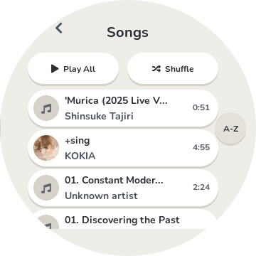<br><sub>36×36 thumbnails & A–Z index</sub> | 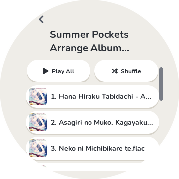<br><sub>Folder playback & shuffle</sub> | 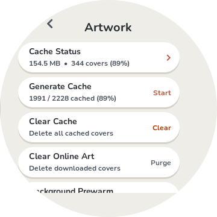<br><sub>Cache status & on-demand generator</sub> |

### Bluetooth Receiver Subsystem & Audio Codec Suite
- **Full 5-Codec Suite**: Adds high-resolution **LDAC** (990/660/330 kbps), **aptX-HD**, **aptX**, **AAC**, and **SBC** support via bundled custom `bluealsa` daemon.
- **Smart Paired Devices Sheet**: Filters paired devices by BlueZ cached profile UUIDs (`0000110a` A2DP Audio Source) so the list shows transmitting audio sources (smartphones, tablets, PCs) while omitting headphones.
- **Live Codec Switcher**: Change Bluetooth receiver codecs on the fly directly from the Mode Lock screen or Now Playing Options hub.
- **Low-Latency Mode**: Reduces A2DP buffer latency (~80–120ms) for synchronized video and gaming audio.

| BT Receiver Mode | Device Selection | Codec Select |
|:---:|:---:|:---:|
| 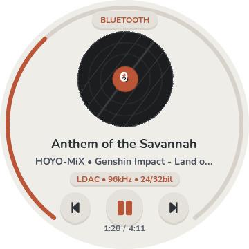<br><sub>AVRCP phone controls & LDAC badge</sub> | 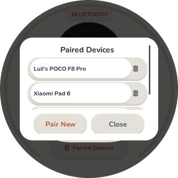<br><sub>Select Devices</sub> | 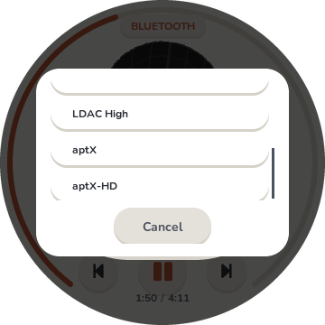<br><sub>Select codec</sub> |

### External USB DAC Host Audio (Mode 4)
- **Host Power Sequencing**: Verifies firmware capabilities (`fw_has_usb_audio_out()`), allowing the DWC2 USB controller to enter host mode and supply 5V VBUS power before enumerating the external DAC.
- **Unblocked Local Playback**: Permits Mode 4 in local playback checks, coldplug mounting, and playlist playback routines.
- **Dedicated Mode Lockdown**: Full-screen status and transport hub for external USB DAC output with sample-rate badges and safe edge-swipe navigation.

| Mode 4: USB Audio Out | USB DAC PC Sound Card Mode |
|:---:|:---:|
| 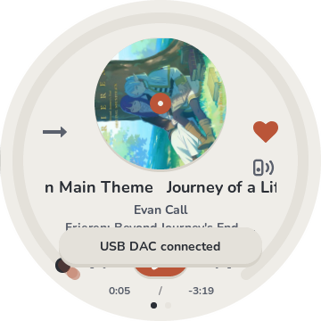<br><sub>External USB DAC host audio</sub> | 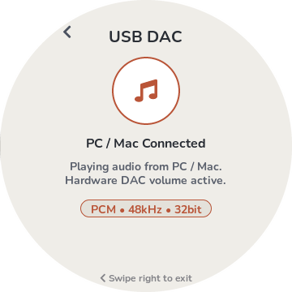<br><sub>Bit-perfect PC sound card mode</sub> |

### Web UI & Wireless Remote Control (`diskos-webd`)
- **Embedded Lightweight Server**: Standalone C99 daemon running on port 8080 with ~2.5 MB RSS footprint.
- **Full Remote Management**: Browser-based playback controls, live volume and seek adjustments, queue jumping, MicroSD file browsing, folder creation, and direct drag-and-drop audio uploads over Wi-Fi.
- **Zero-Reflash Installation**: Can be installed and updated directly on the MicroSD card without flashing rootfs.

| On-Device Web Server Status | Web UI Browser Player |
|:---:|:---:|
| 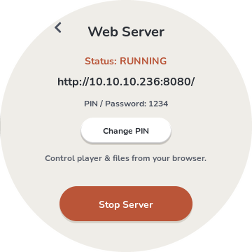<br><sub>Live server toggle & port address</sub> | <br><sub>Remote browser control & queue</sub> |

### Power, Sleep & Display Polish
- **Physical Power Button Wake**: Synchronizes `mq_player` power state via Linux evdev (`KEY_POWER`) injection, eliminating the false-wake loop and screen-off touch freeze.
- **Touch to Wake Toggle**: Switch between CST816T deep sleep (0mA power draw) and responsive tap-to-wake under **Settings > Display > Touch to Wake**.
- **Graceful Safe Shutdown**: Reverse boot splash animation contracts the vinyl disc over Home, displays orbiting spectra during storage flush and filesystem sync, and cuts the backlight rail safely. Triggerable from **Settings > Device > Shut down**, 0% battery countdown, or physical power button hold (3–5s).
- **24-Hour Circular Battery Dial**: Interactive dial under **Apps > Battery & Power** tracking charge percentage, runtime estimates, and screen-on vs. playback active segments.
- **Modal Gesture & Touch Isolation**: Swallows edge back-swipes, rim wheel scrolling, and track scrubbing while modal dialogs or bottom sheets are open, eliminating accidental input bleed-through.
- **Circular Display Polish**: Header font step-down, tightened vertical descent, dialog minimum widths/padding, and inset quick settings layout to prevent bezel clipping on the 360×360 screen.

| 24-Hour Circular Battery Dial | Quick Settings Drawer | Modal Touch Isolation |
|:---:|:---:|:---:|
| 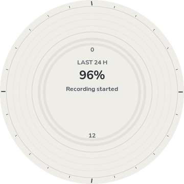<br><sub>Real-time fuel gauge & drain dial</sub> | 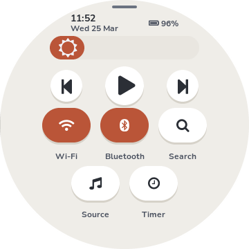<br><sub>Live time, battery & transport</sub> | 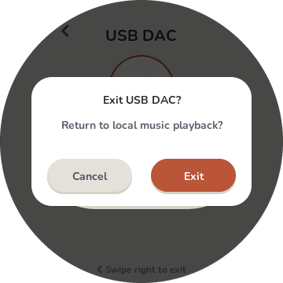<br><sub>Modal scrim & gesture isolation</sub> |

## Features

- **Bespoke Circular UI** — Native 360×360 round-screen interface built on LVGL 9, featuring 8 distinct themes (Bauhaus, Blueprint, Hi-Fi, Terminal, Stone, Zine, and more) with smooth 60 FPS transitions and edge-swipe gestures.
- **Bit-Perfect Local Audio** — Retains FiiO's native audio daemon (`mq_player`) and kernel ioctl routing across all 4× Cirrus Logic CS43131 balanced DACs, supporting FLAC, DSD, WAV, MP3, AAC, and Ogg Opus.
- **Track Artwork in Song Lists** — Renders 36×36 album art thumbnails across Library Songs, Folder Browser, Playlist View, Search, and Up Next lists.
- **Low-Battery Safety & Shutdown** — Notices at <=10% and <=5%, 100% full notice, and a 30-second safe turn-off countdown dialog at 0% battery.
- **Complex Text Shaping** — HarfBuzz and SheenBidi text shaping for Gurmukhi, Devanagari, Urdu, and Hebrew text with right-to-left scrolling.
- **Wireless Streaming with Beam** — Stream audio wirelessly from the Disc's MicroSD card to Google Cast devices and Apple AirPlay speakers or TVs over local Wi-Fi, using the player as a remote control.
- **AirPlay Receiving** — Turn the Disc into a wireless Hi-Fi AirPlay receiver from iOS, iPadOS, and macOS with synchronized volume and live metadata display (requires stock firmware V2.40 or V2.57).
- **Comprehensive Bluetooth Stack** — High-resolution bidirectional Bluetooth supporting LDAC, aptX-HD, aptX, AAC, and SBC, smart paired host management, live codec switching, low-latency mode (~80–120ms), and full AVRCP earbud touch playback controls (Play, Pause, Next, Prev) via dedicated `diskos-avrcpd` bridge.
- **External USB DAC Host Audio** — Bit-perfect digital audio output to external USB DACs over USB-C OTG (Mode 4).
- **Browser Remote Control & Web UI** — Built-in lightweight HTTP/WebSocket daemon (`diskos-webd`) on port 8080 for wireless playback control, queue jumping, volume management, and direct drag-and-drop MicroSD file uploads over Wi-Fi.
- **Dedicated Mode Lockdown** — Distraction-free full-screen dashboards for USB DAC Host Mode, Bluetooth Audio Sink (with phone AVRCP controls), and USB Mass Storage.
- **Power & Sleep Stability** — Real-time ADC fuel-gauge battery tracking, 24-hour circular usage dial, optional Touch-to-Wake (CST816T deep sleep at 0mA), zero-blink single-press power button wake, and multi-stage safe shutdown.
- **Dual-Boot Hardware Fallback** — Hold **Volume Up** during power-on to boot into the stock FiiO UI at any time without reflashing or altering settings.

## Screenshots

### Core Experience & Round-Screen UI

| Home Screen | Now Playing & Halo Ring | Track Artwork in Lists |
|:---:|:---:|:---:|
| 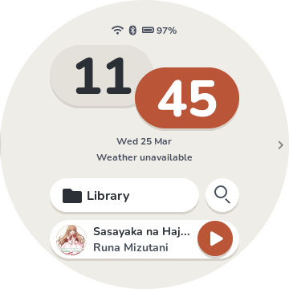<br><sub>Home with live track & clock</sub> | <br><sub>Track controls & progress halo</sub> | <br><sub>36×36 thumbnails & A–Z fast scroll</sub> |

| Album Cover Flow | 24-Hour Battery Dial | Artwork Management |
|:---:|:---:|:---:|
| <br><sub>Visual cover carousel</sub> | <br><sub>Circular usage & battery history</sub> | <br><sub>Cache status & on-demand generator</sub> |

| Quick Settings Drawer | Mode Lockdown (BT Sink) | Circular Keyboard |
|:---:|:---:|:---:|
| <br><sub>Status & control switches</sub> | <br><sub>AVRCP phone controls & LDAC badge</sub> | 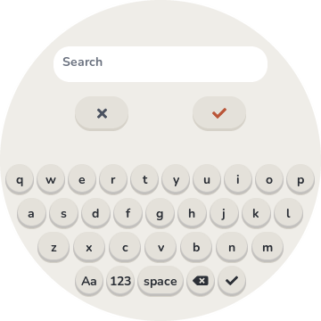<br><sub>Round-screen text entry</sub> |

| Beam to Cast & AirPlay | AirPlay Receiving | Folder Browser |
|:---:|:---:|:---:|
| 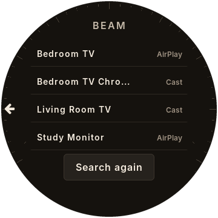<br><sub>Stream to network speakers</sub> | 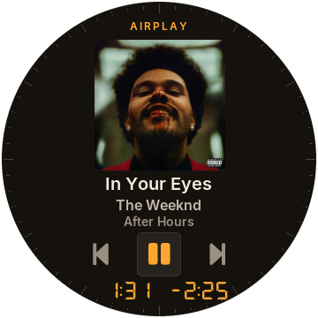<br><sub>Wireless Hi-Fi speaker mode</sub> | <br><sub>Folder-scoped playback & queue</sub> |

Explore every screen, theme, and setting in the **[Complete Interface Tour](docs/TOUR.md)**.

### Web UI & Remote Control

Control playback, browse tracks, and manage your MicroSD card wirelessly from any desktop or mobile browser over local Wi-Fi:

| Player & Turntable | Queue & Track Jump | Wireless File Manager | Device & Audio Settings |
|:---:|:---:|:---:|:---:|
| <br><sub>Live playback & volume</sub> | 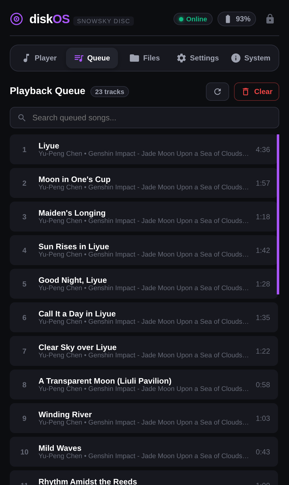<br><sub>Instant queue jumping</sub> | <br><sub>MicroSD file upload & browse</sub> | 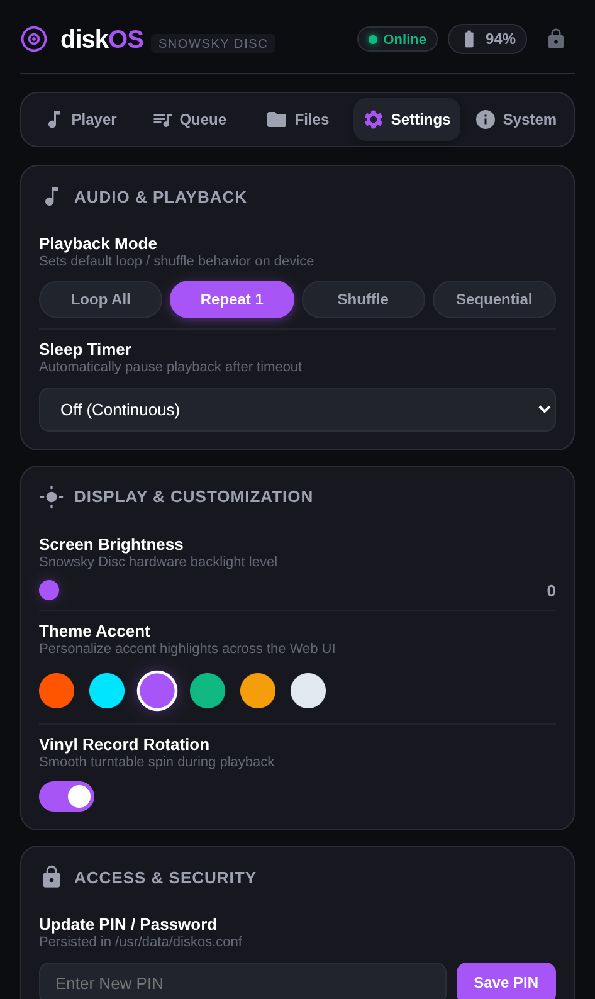<br><sub>Audio modes & sleep timers</sub> |

Read the **[Web UI & Remote Control Guide](docs/WEBUI.md)** for architecture details and REST/WebSocket API endpoints.

## Requirements

| Requirement | Details |
|---|---|
| **Target Device** | FiiO Snowsky Disc (Ingenic X2000 SoC) |
| **Supported Stock Firmware** | V2.09, V2.28, V2.40, V2.57 *(AirPlay Rx & USB Audio Out require V2.40 or V2.57)* |
| **Supported Host OS** | Linux x86-64 (Debian, Ubuntu, Arch, CachyOS, Fedora)<br>macOS (Apple Silicon prebuilt app; Intel builds from source)<br>Windows 10/11 x64 (standalone release ZIP) |
| **Host Runtime** | Python 3.8+ on Linux / source checkouts (bundled inside macOS and Windows releases) |
| **Hardware Connection** | Direct USB-C data cable (avoid unpowered hubs), ~20 uninterrupted minutes |

> [!NOTE]
> The installer does **not** redistribute FiiO's copyrighted root filesystem. It downloads or accepts the user's official FiiO firmware ZIP, unpacks it locally, patches the UI and boot hook, and flashes the resulting image.

## Installation

### Linux

1. Install system prerequisites and configure USB permissions:
   ```bash
   # Debian / Ubuntu:
   sudo apt install python3 python3-tk libusb-1.0-0-dev

   # Arch / CachyOS:
   sudo pacman -S python tk libusb
   ```
2. Configure udev rules for the Ingenic mask-ROM device:
   ```bash
   echo 'SUBSYSTEM=="usb", ATTRS{idVendor}=="a108", ATTRS{idProduct}=="eaef", MODE="0666"' | sudo tee /etc/udev/rules.d/99-ingenic.rules
   sudo udevadm control --reload-rules && sudo udevadm trigger
   ```
3. Run the installer:
   ```bash
   ./diskos-installer
   ```

### macOS

1. Download `diskos-installer-macos-arm64.dmg` from the latest release.
2. Open the DMG and drag **diskOS Installer** to `/Applications`.
3. Open Terminal and run the one-line setup helper to clear macOS Gatekeeper quarantine:
   ```bash
   xattr -cr "/Applications/diskOS Installer.app"
   ```
4. Launch the application from Finder or Spotlight.

### Windows

1. Extract the release ZIP.
2. Launch **diskos-installer.exe**. If Windows SmartScreen displays a warning, select **More info** > **Run anyway**.
3. If prompted by the Ready checklist, select **Set up USB driver...** to configure WinUSB for device `a108:eaef`.
4. Select the matching firmware version, click **Get firmware**, review the checklist, and start the flash.
   *(Command-line workflows use `diskos-installer-cli.exe`)*.

### Device Flashing Procedure

1. **Power off the Disc** completely.
2. **Hold Volume Down** and connect the USB-C cable to your computer. The screen remains black; the device is now in Ingenic mask-ROM mode (`a108:eaef`).
3. In the installer, select **Install diskOS...**, check the confirmation checkbox, and click **Begin flash (~20 min)**.
4. Keep the computer awake and the USB cable connected until verification finishes, then power-cycle the Disc.

> [!TIP]
> **Dual-Boot Fallback**: To boot the stock FiiO UI instead of diskOS, hold **Volume Up** while powering on the Disc. You can also configure the default startup system under **Settings > Device > Default UI**.

## How It Works

```
+-------------------------------------------------------------------------------+
|                            Host PC (Installer)                                |
|  Official FiiO ZIP  --->  Extract Rootfs  --->  Patch diskOS Hook & UI  --->  |
+-----------------------------------------------------------------------|-------+
                                                 Mask-ROM USB (a108:eaef)
                                                                        v
+-------------------------------------------------------------------------------+
|                       FiiO Snowsky Disc (Ingenic X2000)                       |
|                                                                               |
|  [ mtd0: U-Boot ]  --->  [ mtd1: Linux 4.4 Kernel ]                           |
|                                                                               |
|  [ mtd2: Rootfs (SquashFS, Read-Only) ]                                       |
|    |-- /etc/init.d/S97diskos_install (Fail-closed boot hook & manifest check) |
|    |-- /usr/bin/mq_player (Preserved stock audio decoder daemon)             |
|                                                                               |
|  [ mtd7: Data (UBIFS, Writable) - /usr/data ]                                 |
|    |-- /usr/data/bin/mq_ui (diskOS LVGL 9 Round UI)                           |
|    |-- /usr/data/bin/diskos-webd (Embedded HTTP/WebSocket Remote Server)      |
|    |-- /usr/data/etc/ (Saved settings, SQLite databases, Wi-Fi keys)          |
|                                                                               |
|  [ Audio Hardware Routing ]                                                   |
|    |-- POSIX Queue (/player) <---> mq_player <---> /dev/cs43131{a,b,c,d}     |
|    |-- Four Cirrus Logic CS43131 Balanced DACs (L+/L-/R+/R-)                  |
+-------------------------------------------------------------------------------+
```

1. **Image Generation**: The installer extracts the official SquashFS rootfs from your firmware ZIP, injects the diskOS boot hook, and builds a verified image locally.
2. **Fail-Closed Execution**: On boot, `/etc/init.d/S97diskos_install` checks hardware button overrides and validates the UI binary's SHA-256 hash against a baked manifest. If verification fails or Volume Up is held, the device boots the stock FiiO UI.
3. **Audio Architecture**: The stock playback daemon (`mq_player`) manages all hardware decoding and DAC configuration via direct kernel ioctls on `/dev/cs43131{,b,c,d}`. `mq_ui` and `diskos-webd` communicate with the player via POSIX message queues (`/player`), preserving bit-perfect sound output.

## Known Hardware Scope & Limits

- **Wi-Fi**: 2.4 GHz only. The wireless chip is a Broadcom BCM43438 / AP6212 (Wi-Fi + BT over UART); there is **no 5 GHz** hardware support.
- **Display & Acceleration**: UI rendering is performed on the CPU via LVGL 9 with MIPS MSA SIMD optimization. The Ingenic X2000 has no GPU, VPU, or hardware JPEG decoder.
- **Audio Controls**: The four CS43131 DACs are driven by kernel ioctls, not standard ALSA mixer controls.
- **Mask-ROM Flashing**: The hardware mask-ROM USB link permits roughly one flashing run per power cycle. If a run stalls during connection, power-cycle the Disc back into mask-ROM mode and retry.
- **Firmware Variations**: AirPlay Receiving and USB Audio Output require stock firmware V2.40 or V2.57. On V2.57, Custom EQ edits ten-band USER presets; advanced parametric presets stay view-only.

## Troubleshooting & Recovery

If a flash operation is interrupted or reports an error:

1. **Do not panic**: The Ingenic mask-ROM bootloader lives in read-only on-chip ROM. It cannot be erased, overwritten, or bricked by a software flash.
2. **Leave connected if write was in progress**: If the host tool encountered a timeout while writing blocks, leave the Disc powered and connected for 25 minutes to allow on-device writes to complete.
3. **Power cycle into recovery**: Turn off the Disc (hold Power for 10 seconds), hold **Volume Down**, and reconnect USB.
4. **Restore stock firmware**:
   ```bash
   ./diskos-installer restore-stock
   ```
   Or select **Restore stock firmware...** from the graphical installer.

For a comprehensive error code table (`E1xx` preflight, `E2xx` build, `E3xx` flash, `F1xx` writer), see the **[Installation Troubleshooting Guide](docs/INSTALL.md#restore-stock-and-recover)** and **[RECOVERY.txt](RECOVERY.txt)**.

## Documentation

| Guide | Description |
|---|---|
| [**Documentation Index**](docs/README.md) | Central hub and overview for all project documentation. |
| [**Installation Guide**](docs/INSTALL.md) | Full setup, package lists, udev rules, and flashing details. |
| [**Interface Tour**](docs/TOUR.md) | Comprehensive tour of all screens, themes, gestures, and settings. |
| [**Web UI & Remote Control**](docs/WEBUI.md) | Architecture, REST/WebSocket APIs, and file manager documentation. |
| [**Hardware Capability Map**](docs/HARDWARE.md) | Detailed specifications, SoC registers, DAC interfaces, and pinouts. |
| [**Design System**](docs/DESIGN_SYSTEM.md) | Visual design tokens, round-screen layout rules, and font specs. |
| [**Developer Workflow**](docs/DEV_WORKFLOW.md) | Compiling the UI, cross-toolchains, QEMU emulation, and SSH debugging. |
| [**IPC Command Map**](docs/COMMAND_MAP.md) | Communication protocol between `mq_ui` and FiiO's `mq_player`. |
| [**Reverse Engineering**](docs/RE_CATALOGUE.md) | Catalogue of stock binaries, audio libraries, and ioctl commands. |
| [**Privacy & Network Use**](docs/PRIVACY.md) | Network disclosure, offline guarantees, and Last.fm privacy details. |

## Contributing

Bug reports, hardware findings, documentation fixes, and focused patches are welcome.
Read [CONTRIBUTING.md](CONTRIBUTING.md) before changing flashing or security-sensitive code.
Report vulnerabilities privately through [SECURITY.md](SECURITY.md).

## License and Support

diskOS is free software under the GNU GPL v3.0 or later; see [LICENSE](LICENSE). This covers the
installer, scripts, documentation, the on-device UI in [ui/](ui/) and the website in [site/](site/).
Third-party components keep their own licences (see [NOTICE.md](NOTICE.md)). Releases up to 1.2.2
published the installer and tools under the MIT licence; see [NOTICE.md](NOTICE.md).
Third-party license details and corresponding source are listed in [NOTICE.md](NOTICE.md),
[SPL_SOURCE.md](SPL_SOURCE.md), and [licenses/](licenses/).

> [!WARNING]
> Do not redistribute generated `diskos_*.bin` images. They contain FiiO's root filesystem.
> Build them locally from firmware you obtained from FiiO and share the installer instead.
