# A tour of diskOS 1.2.2

diskOS is a touch interface for the FiiO Snowsky Disc's 360x360 screen. Local playback uses the player supplied by the installed stock firmware; Beam plays through the selected receiver. The available player controls differ on V2.09, V2.28, V2.40, and V2.57; unavailable firmware-specific controls say "Not on this firmware". AirPlay Receiving is offered on V2.40 and V2.57 only.

[Home](../README.md) | [Install](INSTALL.md) | [Docs](README.md)

## On this page

- **Getting around:** [Home](#home), [Quick Settings](#quick-settings), [Volume](#volume), [Back and Home gestures](#back-and-home-gestures), [Screensaver and screen off](#screensaver-and-screen-off).
- **Listening:** [Now Playing](#now-playing), [Now Playing menus](#now-playing-menus), [Beam](#beam), [AirPlay Receiving](#airplay-receiving), [Up Next](#up-next), [Song Info and lyrics](#song-info-and-lyrics), [Equalizer](#equalizer).
- **Your library:** [Library](#library), [Search and keyboard](#search-and-keyboard), [Favourites and History](#favourites-and-history), [Playlists](#playlists), [Books and chapters](#books-and-chapters), [Browse Files](#browse-files).
- **Make it yours:** [Settings](#settings), [Playback](#settings-playback), [Audio](#settings-audio), [Network](#settings-network), [Display](#settings-display), [Library](#settings-library), [Controls](#settings-controls), [Battery & Power](#settings-battery--power), [Device](#settings-device), [Eight themes](#eight-themes).
- **Network and apps:** [Wi-Fi and Bluetooth](#wi-fi-and-bluetooth), [Apps, Last.fm, and weather](#apps-lastfm-and-weather).
- **Updates and safety:** [Updates, startup, and power](#updates-startup-and-power), [Limits](#limits), [Safety and stock UI](#safety-and-stock-ui).

## Getting around

### Home

Home shows the time, date, battery, current song, and a weather glance when weather is enabled. Tap Library to browse music, Search to find a song, the play button to pause or resume, or the current song to open Now Playing. In halo, the now-playing island's border shows playback progress. Tap the weather glance, including "Weather unavailable", to open Weather. Swipe left to Apps, swipe down from the top edge for Quick Settings, or use the left-edge right swipe to go back from other screens.

<table>
<tr>
<td align="center" valign="top" width="33%">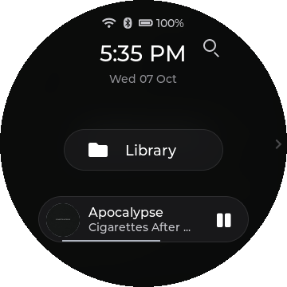 Home with a playing song</td>
</tr>
</table>

### Quick Settings

Pull down from the top edge to open the drawer and swipe up to close it. Drag Brightness at the top; an optional row adds previous, play or pause, and next. Choose up to six tiles under Settings > Controls > Quick Settings, or five when playback controls are shown. A tap acts immediately; holding Wi-Fi, Bluetooth, EQ, Shuffle, Gapless, High Gain, DRE, Outdoor, or Theme opens its full setting.

| Tile | Tap action |
|---|---|
| Wi-Fi; Bluetooth | Toggle the radio. |
| EQ | Switch between Off and the last preset, starting with Rock. |
| Search; Rescan; Source; Screen off | Open Search, start or stop a library scan, open Audio Source, or turn the screen off. |
| Shuffle; Favourite; Lyrics; Timer | Toggle Shuffle, toggle the current song's favourite state, open Lyrics, or open Sleep Timer. |
| Gapless; High Gain; DRE | Toggle the named audio setting; High Gain reports unsupported firmware when its command is unavailable. |
| ReplayGain; Outdoor; Theme | Open ReplayGain, toggle Outdoor Mode, or cycle to the next theme. |
| Beam | Open the Beam picker; lit, with the receiver's name, while you are beaming. |

Wi-Fi, Bluetooth, EQ, Search, Rescan, and Source are the initial tiles. The other tiles, including Beam, and the playback controls start hidden until selected in the tile picker. Tiles that depend on a song or supported firmware can report why an action was refused. The drawer's handle is at the bottom, where the swipe up that closes it starts.

<table>
<tr>
<td align="center" valign="top" width="33%">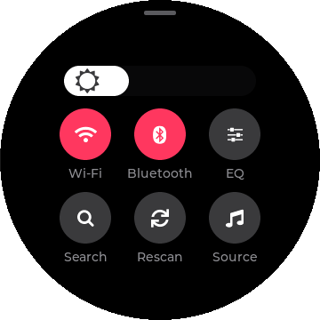 Initial drawer</td>
<td align="center" valign="top" width="33%">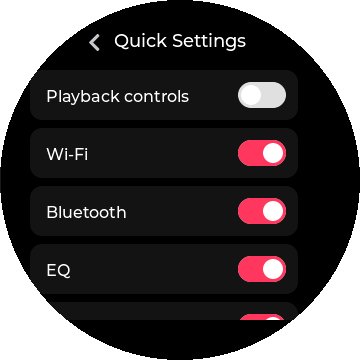 Available tile switches</td>
</tr>
</table>

### Volume

Press a volume key to change the level when that key action is set to Adjust Volume; the on-screen volume display appears with the new value. Drag its arc to set a level; it closes by itself shortly after the last change. Audio > Max Volume caps the value sent to the player. Volume key press, double press, and long press actions can be changed on V2.57.

<table>
<tr>
<td align="center" valign="top" width="33%">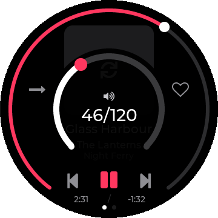 Volume arc and number</td>
</tr>
</table>

### Back and Home gestures

Swipe right from the left edge to go Back one page. Swipe up from the bottom edge of the screen to go Home. Going Home closes the screens above it; Library next opens at its top level. Slow left-edge Back swipes also work where another control does not own the gesture.

### Screensaver and screen off

After the Screensaver delay, the screen enters idle dimming; Cover and Vinyl savers open automatically only during playback. Vinyl with a cover keeps your chosen brightness. The Screen Off delay then turns the panel fully off unless set to Off. Choose Cover, Analog, Minimal, Digital, Vinyl, or Custom under Saver Style, which opens a list of choices. Set Screensaver to Off to disable both automatic idle stages. Touch wakes diskOS idle dimming and Screen Off; use the power button if the stock player put the panel to sleep.

Song text appears while playing and hides when paused; optional weather appears where the style has room. The smaller, raised Analog dial leaves room for song text. Vinyl hides song labels while showing a spinning cover, but keeps text when no cover is available. Titles and artists refresh between tracks from a CUE sheet or SACD ISO, even when their file path is shared.

Custom shows your own picture: put JPG, PNG, BMP or GIF files in the CustomCover folder on the SD card, then choose Saver Style > Custom > Choose Image. Stills must be at most 16 MiB and 8,000,000 pixels. A preview screen opens first; JPG, BMP and PNGs above 2 MiB or 1024 pixels on either side show a placeholder; Use Image applies it, and Use Saved Image reselects the last one. An animated GIF must be 4 MiB or smaller and no larger than 364 x 364, and it animates only while the screen is lit. Overlays adds Time, Date, Battery, Now Playing and Weather; Font offers Theme, Plain, Digital, Mono and Rounded; Position puts the text at the top, centre or bottom. If the image cannot be used, the saver shows Minimal.

Time and Date start on, using the Theme font at the bottom. Preview shows the complete result, with labelled sample track or weather data when needed. Tap Save to keep overlay, font and position changes; leaving Custom without saving discards them. Custom weather uses the last reading, marks older readings Cached and hides them after two hours. No new weather requests start while Custom or Preview is visible; an existing request can still finish. The Analog saver shows the correct hands immediately, and Something keeps its clock colon steady on Home and the saver.

<table>
<tr>
<td align="center" valign="top" width="33%">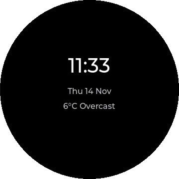 Default saver style</td>
</tr>
</table>

## Listening

### Now Playing

Now Playing shows the current song, elapsed and remaining time, playback controls, play mode, and a Favourites heart; most themes also show cover art and album. Tap previous, play or pause, and next for transport; tap the heart to add or remove the current music track from Favourites, and tap the mode icon to cycle Sequential, Shuffle, Repeat One, Repeat All, and Single. Drag the progress control to seek, tap visible cover art for full-screen art (the current track's sharp cover, edge to edge), and tap the moon to choose a sleep timer; a book also offers End of chapter. Swipe left across the page to the Options hub, or open its context and tuning panels with the on-screen side controls; a deliberate right swipe returns, while a short drag on the seek control stays a seek. The Beam button beside the heart opens the Beam picker.

The Display > Now Playing choice sets Cover or a spinning Vinyl image. halo and something place art inside a round seek ring; hi-fi adds an LCD-like time readout, blueprint adds cover crop marks, and stone uses a thick ring and pill-shaped play key. Bauhaus splits the art and controls with a straight seek bar, zine tapes art above a highlighter-style bar, and terminal hides art for a text readout and straight bar. Vinyl freezes when paused and spins while the screen is showing a playing track that has cover art; a missing cover uses a still placeholder where art is shown.

<table>
<tr>
<td align="center" valign="top" width="33%">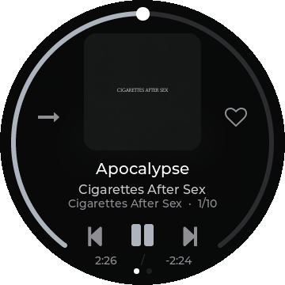 halo cover layout</td>
<td align="center" valign="top" width="33%">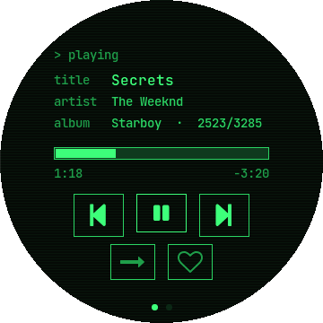 Terminal's straight seek bar</td>
</tr>
<tr>
<td align="center" valign="top" width="33%">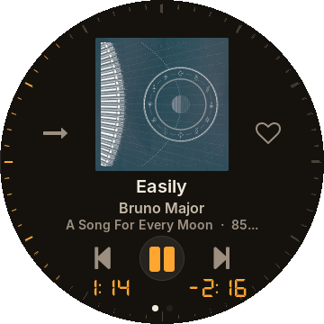 Hi-fi faceplate layout</td>
<td align="center" valign="top" width="33%">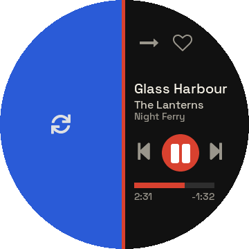 Bauhaus split layout</td>
<td align="center" valign="top" width="33%">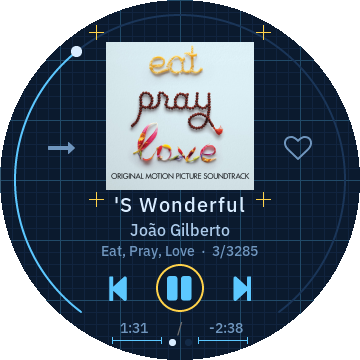 Blueprint cover layout</td>
</tr>
<tr>
<td align="center" valign="top" width="33%">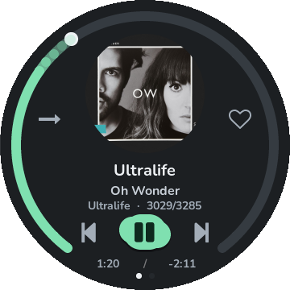 Stone's rounded controls</td>
<td align="center" valign="top" width="33%">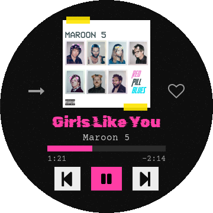 Zine's paper layout</td>
</tr>
</table>

### Now Playing menus

The Options hub opens Beam (its value shows where the sound goes: This Disc or the receiver), Up Next, full-screen art, Equalizer, Song Info, Lyrics, the current Album or Artist, and Add to Playlist for a music track. For an audiobook it instead offers Chapters, Book details, Equalizer, and full-screen art. The separate context panel provides Favourites, Add to Playlist, Song Info, and Album or Artist shortcuts. The tuning panel has left and right controls for Play Mode and Equalizer, plus a Custom EQ shortcut; tap a row or arrow to make the shown choice and use Back to return.

<table>
<tr>
<td align="center" valign="top" width="33%">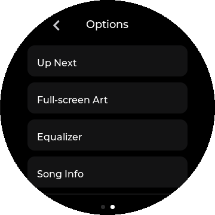 Music options hub</td>
<td align="center" valign="top" width="33%">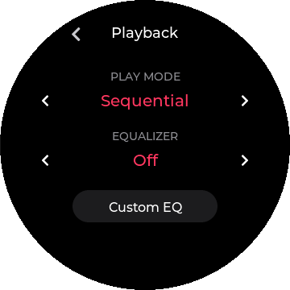 Play mode and EQ controls</td>
</tr>
</table>

### Beam

Beam plays the current music on a speaker or TV on your Wi-Fi. Open it from the Beam button on Now Playing, the first row of the Options hub, or the optional Beam tile in Quick Settings (add it under Settings > Controls > Quick Settings). The picker lists the Cast and AirPlay devices it finds, each tagged with its type; AirPlay 1 receivers are tagged "AirPlay 1". Use the same home Wi-Fi as the receiver: guest networks may block discovery.

If Wi-Fi is off, tap Wi-Fi settings to connect. Use Search again to refresh the picker after no devices are found or a search fails. Tap a device to connect; Cancel stops a connection attempt. The Disc keeps playing until the receiver is ready.

AirPlay PIN pairing uses a keypad on the Disc; enter the digits shown by the receiver and tap Pair. Successful pairing is remembered. If pairing fails before PIN entry, Beam keeps the failure on screen so you can try again. After a PIN or verification failure, Forget pairing clears the saved pairing before retrying. Password-protected AirPlay 1 receivers are not supported.

While you beam, the Disc stays quiet. Play, pause, skip, seek, volume keys and the volume dial act on the receiver. Now Playing says "Beaming to" with its name, or "Paused -" with its name when paused. Before starting, set all three volume-key actions (Press, Double Press and Long Press) to Adjust Volume under Settings > Controls. If they need changing, the picker explains this before listing devices and its Controls button opens that category directly. You cannot change them to Switch Track during Beam.

Compatible AirPlay receivers show the track's cover, title, artist and progress. TV remotes can play, pause and skip to the next or previous track where supported. Cast and AirPlay covers update with the track; Beam waits up to 15 seconds for a cover that is not ready when playback starts.

Library selections, Favourites, playlists and play modes control the remote queue. Up Next shows that queue and lets you jump to a track. During AirPlay beaming, hold an upcoming track for Play next, Remove from Up Next or Cancel. Unsupported entries show why they cannot play; automatic progression reports skipped tracks. Favourite toggles for the playing track are unavailable while beaming, lyrics follow the remote track, and Song Info hides the Disc's output sample rate. Cast listening can scrobble to Last.fm when enabled; AirPlay sending and receiving do not.

Stop beaming ends the session. When the current track can continue on the Disc, it also resumes the last playback position once the receiver is known to have stopped. If Cast has no track to resume, the Disc stays paused. Cast also offers Play on Disc. After a different remote queue was selected, only the current track returns to the Disc. During AirPlay beaming, Play on Disc opens a confirmation: it can continue the original queue or, when that queue cannot be restored, play only the current track. Returning playback no longer briefly plays from 0:00 or flashes 0:00 on the clock. If stopping the receiver was not confirmed, the Disc warns that the TV may still be playing; stop it first. Choose Keep beaming to cancel the return while the session is active.

Beam to Cast supports MP3, AAC, Opus, Ogg Vorbis, and 16- or 24-bit FLAC and PCM WAV up to 96 kHz, in mono or stereo. Google Home Mini receivers accept FLAC up to 48 kHz. ALAC, AIFF, WMA, APE, DSD and WavPack cannot be sent to Cast. AirPlay decodes mono or stereo MP3, FLAC and PCM WAV at 8-384 kHz, and converts AAC, ALAC, Opus, Ogg Vorbis, WMA, APE and DSD for the receiver as it plays. AirPlay output is 44.1 or 48 kHz at 16 or 24 bits, depending on receiver support; AirPlay 1 uses 44.1 kHz at 16 bits. The Beam screen shows the output rate and bit depth and offers a Volume button. Unsupported files, SACD ISO files, CUE tracks and audiobooks cannot be beamed and say so.

Remote sessions hold off idle shutdown while in use. The sleep timer ends remote playback. Cast control messages are encrypted, but the Disc does not check the receiver's identity. Music and artwork are sent over plain HTTP on your local network. Use a network you trust. See [Privacy](PRIVACY.md) for network details.

### AirPlay Receiving

On V2.40 and V2.57, choose AirPlay Receiving as a source (Quick Settings > Source, or Settings > Network > Audio Source), then pick SNOWSKY DISC on your iPhone or Mac. The Disc must be on Wi-Fi. The row is hidden on V2.09 and V2.28.

The receiving view follows your theme and shows the track, artist and cover the sender provides. Use previous, play/pause and next to control playback. When the sender provides usable timing, Now Playing shows progress or elapsed and remaining time, depending on the theme. Timing stays hidden when it is unavailable.

If Wi-Fi disconnects, open Wi-Fi settings from the receiving screen. A failed or uncertain start offers retry. Options contains Return to Local and Source. Return to Local takes you back to local playback; if asked "Stop receiving and return to the Disc's music?", choose Return or Cancel. A sleep timer ends receiving. Idle power-off stays blocked while AirPlay Receiving is selected, including failed or uncertain receiving states.

### Up Next

Open Up Next from the music Options hub to see the current song and the player's upcoming order. Tap the current row to return to Now Playing, or tap an upcoming row to jump there. The list refreshes when the track or play mode changes and reports when the player's queue is being rebuilt. It shows at most 100 upcoming rows, with the rest summarized; local playback has no add, remove, or reorder action. During Beam it shows the remote queue; AirPlay offers the hold actions described above. Choosing a row returns directly to the existing Now Playing screen, without adding another copy to Back history.

<table>
<tr>
<td align="center" valign="top" width="33%">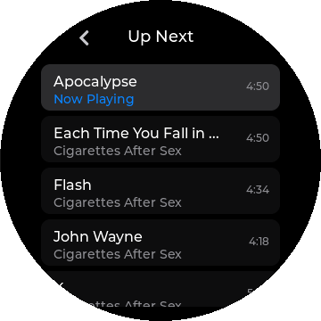 Current and upcoming songs</td>
</tr>
</table>

### Song Info and lyrics

Song Info displays the current file's available title, artist, album, genre, format, sample rate, bit depth, bitrate, channels, duration, size, folder, and filename. Unknown bit depth, bitrate, channel count, and size are hidden; unknown sample rate and duration show "-". For a book the labels change to Author, Progress, and Total length, with Narrated by when available. Scroll the page to see lower fields and use Back to return.

Lyrics first looks for a local .lrc beside the song, then lyrics embedded in its tags; with Online Lyrics enabled it can look up missing words over Wi-Fi. Timed .lrc lines follow the track position and can be scrolled by hand; plain lyrics can be read as a scrolling page. The online switch affects diskOS's lookup only, so local or embedded words still work when it is Off. Tap Back to return to the song.

<table>
<tr>
<td align="center" valign="top" width="33%">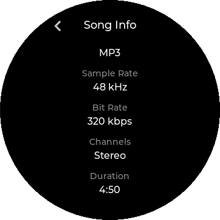 Available track details</td>
<td align="center" valign="top" width="33%">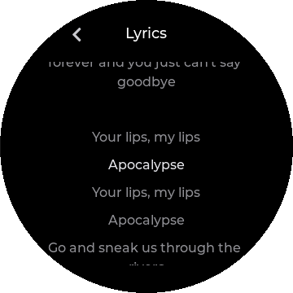 Timed local lines</td>
</tr>
</table>

### Equalizer

The Equalizer row offers Off, Jazz, Rock, R&B, Hip-Hop, Pop, Dance, Classical, Retro, Sibilance 1 and 2, and USER1 through USER10. Custom EQ shows ten fixed bands from 32 Hz to 16 kHz plus a master level; choose a USER slot, scroll sideways to reach more bands, and drag its sliders within -12 to +12 dB. The controls leave space for longer fitted page titles. If a slot cannot be read, the previous curve and slot stay visible; editing is refused until a successful read. Retry the slot selection. On firmware where the stock curve can be written, changes save to that slot and are sent to the player. On V2.57 the Custom EQ editor is view-only: sliders are dimmed, and tapping a band explains "Not on this firmware".

<table>
<tr>
<td align="center" valign="top" width="33%">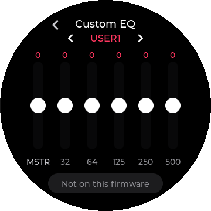 Ten-band editor</td>
</tr>
</table>

## Your library

### Library

Library opens Songs, Albums, Artists, Genres, Playlists, Favourites, Folders, Books, and History. History contains Most Played and Recently Played. Tap a category and then an item to open its next level; tap a song to play it, or use Play and Shuffle at the top of a song list. Hold an album, artist, or genre row to play its songs, and use the Add to Playlist row inside an album, artist, or genre song list to add that displayed group. Drag along the outer edge to scroll a long list, or tap the A-Z control and a letter to jump; the left-edge right swipe remains Back.

Songs is the complete indexed music list. Artists and Genres open a list of their albums plus All Songs, while Albums opens an album's cover and tracks. Album View can switch the Albums list to Cover Flow: flick or drag the covers, use the rim to move through them, tap the centered album to open its tracks, or hold it to play the album. A cover wall can show placeholders until artwork has been cached; playing a track with art can fill that cache.

Missing or blank artist tags appear together under "Unknown artist"; open or play that group to find its songs. Returning from Now Playing to the top-level Songs, Albums, Artists, or Genres lists no longer reloads them. Back and returns from another screen restore the list position with the opened item in view. After a rescan, Cover Flow removes deleted albums and retries a failed reload.

<table>
<tr>
<td align="center" valign="top" width="33%">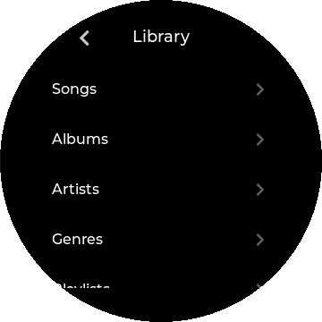 Library categories</td>
<td align="center" valign="top" width="33%">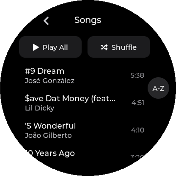 Indexed song list</td>
<td align="center" valign="top" width="33%">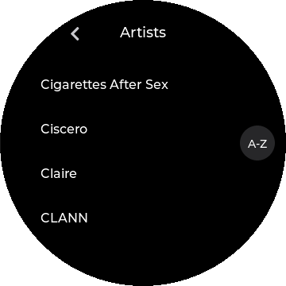 Artist groups</td>
</tr>
<tr>
<td align="center" valign="top" width="33%">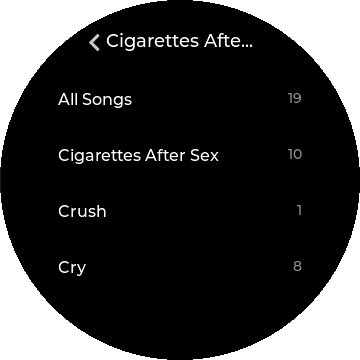 All Songs and album drill</td>
<td align="center" valign="top" width="33%">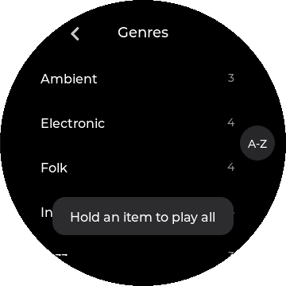 Genre groups</td>
<td align="center" valign="top" width="33%">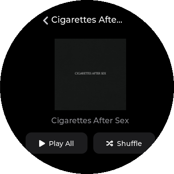 Cover and track list</td>
</tr>
<tr>
<td align="center" valign="top" width="33%">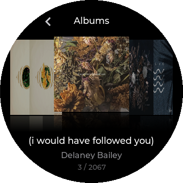 Album cover browsing</td>
<td align="center" valign="top" width="33%">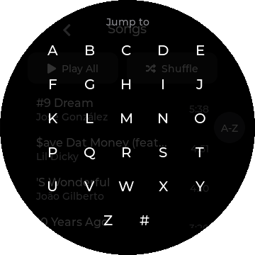 A-Z jump control</td>
</tr>
</table>

### Search and keyboard

Tap Search on Home or in Quick Settings, then tap the wider search field below the page title to open the on-screen keyboard. Search matches indexed song, artist, and album information and shows song results; tap a result to play it, or tap X to clear the query. The keyboard has case, number and symbol, space, backspace, OK, and cancel controls; hold backspace to clear the field. Search shows at most 80 results and asks you to narrow a longer match list. Text over the input limit shows "Text too long" instead of being cut short.

<table>
<tr>
<td align="center" valign="top" width="33%">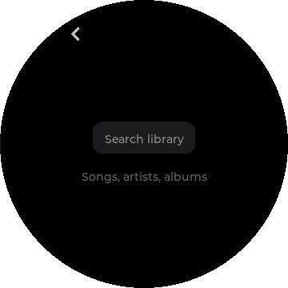 Empty search field</td>
<td align="center" valign="top" width="33%">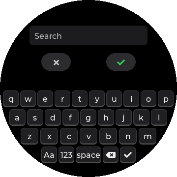 Text entry keys</td>
</tr>
</table>

### Favourites and History

Tap the heart on Now Playing, use the current-song context action, or enable the Quick Settings Favourite tile to change the current song's state. Library > Favourites lists loved tracks; tap one to play it and hold one to remove it. Play and Shuffle act on the Favourites list. A failed favourite removal shows an error. Favourite toggles for the playing track are unavailable during Beam. History's Most Played and Recently Played lists let you tap a song to play it; their order follows listening history rather than the alphabet.

<table>
<tr>
<td align="center" valign="top" width="33%">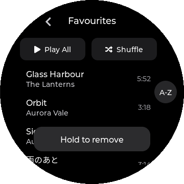 Loved tracks</td>
</tr>
</table>

### Playlists

Library > Playlists lists saved playlists with song counts. Tap New Playlist and type a name, or use Add to Playlist from a playing song or a displayed album, artist, or genre group; choose a playlist in the picker. Tap a playlist to see its ordered songs, Play and Shuffle buttons, and its menu. Tap a song to play it, hold a song to remove that entry, or use the menu to Edit Name, Export to SD as M3U, or Delete Playlist after confirmation; deleting a playlist leaves music files alone. Settings > Library > Import Playlists searches the card for .m3u and .m3u8 files and imports recognized library tracks, keeping a separately named copy when a same-name list differs. Failed creation, additions, removals and imports report an error; failed creation keeps the keyboard and entered name open so you can retry.

<table>
<tr>
<td align="center" valign="top" width="33%">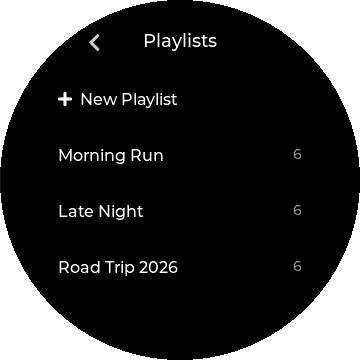 Playlist list and New Playlist</td>
<td align="center" valign="top" width="33%">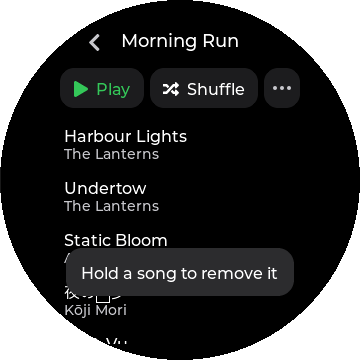 Ordered playlist songs</td>
<td align="center" valign="top" width="33%">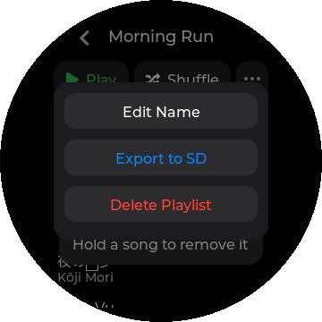 Rename, export, and delete</td>
</tr>
<tr>
<td align="center" valign="top" width="33%">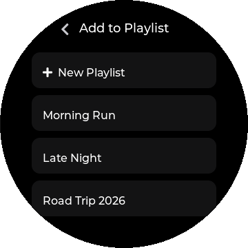 Choose a destination list</td>
</tr>
</table>

### Books and chapters

Library > Books lists indexed .m4b audiobooks separately from music, with author and saved progress. Tap a book to resume; after time away, diskOS rewinds the saved position slightly, and a finished book starts from the beginning. From a playing book, open Options > Chapters and tap a chapter to seek to its start; Book details opens the information page. The Now Playing moon offers End of chapter for books, and books stay in Single play mode. Chapters and narrator details load in the background; the chapter list shows "Loading chapters..." until ready, or "Chapters unavailable" if the information cannot be read. A failed position save shows an error; retry before relying on a new saved position.

### Browse Files

Library > Folders opens the microSD card as folders and files. Tap a folder to descend, the header Back control to ascend, or a supported file to request playback. Tapping a .cue sheet or an indexed SACD .iso starts its indexed tracks in track order. A file must already be in the library database: an unindexed selection reports "Not in library", and ordinary file playback uses the all-songs queue rather than a folder-only queue.

## Make it yours

### Settings

Settings has eight pages in display order: Playback, Audio, Network, Display, Library, Controls, Battery & Power, and Device. From Home, swipe left to Apps and tap Settings. Choose a page to reach its rows. Some rows open a picker or further controls. Short section headings inside longer pages are labels, not buttons. Scroll the pages by swiping; Settings does not use rim scrolling. Each page remembers its scroll position, choice pickers reveal the current selection, and setting shortcuts reveal the relevant row. Changing Outdoor Mode returns to its setting.

Switches sit on their rows. Tap a choice row to open its detail and use the arrows or choice list; sliders can be dragged. Equalizer and Saver Style open lists of choices. Most rows have no help line, with a few short hints such as Gain and ReplayGain. Actions such as Restart, Reset, and updates ask for confirmation where a change will be made. Firmware-specific controls explain when unavailable.

The tables show diskOS's defaults. Artists, Play Through Folders, Automatic Time, Charging Limit, Screen Rotation, and volume-key actions initially follow the saved stock-player values. Play Mode, Resume Playback, Gapless, Max Volume, and Balance keep the player's existing state at startup until a diskOS choice is saved.

### Settings: Playback

#### Playing music

| Row | Action and default |
|---|---|
| Play Mode | Sequential by default; choose Shuffle, Repeat One, Repeat All, or Single. |
| Resume Playback | Off by default; Position resumes the spot, Song reopens the last track. |
| Play Through Folders | Off by default; asks the supported stock player to continue to the next group. Available on V2.28, V2.40, and V2.57. |

#### Bedtime

| Row | Action and default |
|---|---|
| Sleep Timer | Off by default; choose 15, 30, 45, 60, or 90 minutes. Resets on restart. |
| When Sleep Ends | Pause by default; V2.57 can instead request Shut down. |

### Settings: Audio

Audio controls equalization, DAC options and output limits. SPDIF Output is available only in test builds; external USB Audio controls are absent from the normal build.

#### Equalizer

| Row | Action and default |
|---|---|
| Equalizer | Off by default; open the list of built-in and USER presets. |
| Custom EQ | Open the ten-band USER preset editor. |

#### Sound

| Row | Action and default |
|---|---|
| Gain | Off (Low) by default; switch On for High gain for demanding headphones. Unknown firmware says "Not on this firmware". |
| DAC Filter | Slow LL by default; choose Fast LL, Slow PC, Fast PC, NOS, or Wideband. |
| ReplayGain | Off by default; choose Track or Album leveling. |
| DRE | On by default; switch the player's Dynamic Range Enhancement on or off. |
| Gapless | Off by default; switch gapless playback on or off. |

#### Output limits

| Row | Action and default |
|---|---|
| Max Volume | 120 by default; drag the cap from 10 to 120. |
| Balance | Centered at 0 by default; drag from -10 left to +10 right. |

### Settings: Network

Switch a radio on its row, tap the row to open it, rescan, and tap a listed device or network. Bluetooth Codec is available on V2.57; older bases say "Not on this firmware". Further taps are disabled while a radio starts. USB DAC makes the Disc a sound card for a computer. USB Storage gives the computer the card: eject it safely before returning to Local Playback.

| Row | Action and default |
|---|---|
| Wi-Fi | Switch the radio on the row; tapping the row while it is off turns it on, and tapping it while it is on opens scanning, connection, and saved-network details. |
| Bluetooth | Switch the radio on the row; tapping the row while it is off turns it on, and tapping it while it is on opens scanning, pairing, connection, and device details. |
| Bluetooth Codec | SBC by default; V2.57 offers AAC, LDAC Mobile, LDAC Standard, and LDAC High. The stock player applies the chosen codec; changing this row sends the choice at once. An unsupported headphone can fall back to SBC. |
| Device name | The Disc's network name (letters, digits and hyphens, up to 32 characters, starting and ending with a letter or digit) and the name Beam shows to receivers. Applies after a restart; needs a 1.2.2 full flash. Reset this name returns to the stock default. |
| Bluetooth name | The name other Bluetooth devices see (printable ASCII, up to 32 characters and nine words). Reset this name returns to SNOWSKY DISC. A pending change applies when Bluetooth is available. |
| Audio Source | Open Local Playback, Bluetooth Receiving, AirPlay Receiving (V2.40 and V2.57), USB DAC, or USB Storage. Local Playback is the usual music mode. |

### Settings: Display

Display controls appearance and idle behavior. Changing theme or text size redraws the interface while music continues. Outdoor Mode holds a light appearance and full brightness until switched off, then restores the saved appearance and brightness.

#### Screen

| Row | Action and default |
|---|---|
| Brightness | 40% by default; drag from 10% to 100%. Outdoor Mode holds full brightness. |
| Font Size | Medium by default; Small and Large affect list and body text, not clocks and titles. |
| Screen Rotation | Normal by default; 90, 180, or 270 degrees with a keep or revert prompt on V2.57. |
| Outdoor Mode | Off by default; light screens and full brightness. |

#### Appearance

| Row | Action and default |
|---|---|
| Theme | halo by default; open the list of eight themes. |
| Appearance | Dark by default; choose Dark or Light. |
| Accent Colour | Choose cover-derived color or a fixed color. |
| Animations | On by default; switch screen transitions on or off. |

#### Music and Home

| Row | Action and default |
|---|---|
| Now Playing | Cover by default; choose Cover or spinning Vinyl art. |
| Weather on Home | On by default; Off hides passive weather and skips startup and periodic background fetches. |

#### Screensaver

| Row | Action and default |
|---|---|
| Screensaver | 1 min by default; choose Off, 30 sec, 1 min, 2 min, or 5 min. Off disables both automatic idle stages. |
| Saver Style | Cover by default; open Cover, Analog, Minimal, Digital, Vinyl, or Custom. Custom opens image and overlay choices described under Screensaver and screen off. |
| Screen Off | 2 min by default; choose Off, 30 sec, 1 min, 2 min, or 5 min. |

### Settings: Library

#### Browsing

| Row | Action and default |
|---|---|
| Artists | By Artist by default; By Album Artist uses album-artist tags. Unsupported firmware says "Not on this firmware". |
| Track Numbers | Off by default; show numbers in album song lists. |
| Album View | List by default; choose List or Cover Flow for Albums. |

#### Artwork and lyrics

| Row | Action and default |
|---|---|
| Online Album Art | Off by default; look up a missing album cover over Wi-Fi. |
| Album Art Cache | Covers only by default; optional background decoding When Idle or Idle & Charging. |
| Online Lyrics | On by default; permit lookup of missing words over Wi-Fi. |

#### Maintenance

| Row | Action and default |
|---|---|
| Tag Encoding | Auto by default: guess legacy Cyrillic (CP1251) tags and CUE-sheet text. Western keeps the previous decoding; Cyrillic reads legacy text as CP1251. Use Rescan Library after changing the choice to apply it to existing songs; valid UTF-8 and UTF-16 tags are unchanged. |
| Rescan Library | Scan the card with progress shown; tap Stop to cancel pending scan changes. |
| Import Playlists | Import recognized .m3u and .m3u8 lists from the card. |

### Settings: Controls

| Row | Action and default |
|---|---|
| Quick Settings | Open the tile picker and optional playback-control row. Choose up to six tiles, or five with playback controls; the picker shows the selected count and available capacity. Beam starts hidden. |
| Vol Keys: Press | Adjust Volume by default; on V2.57 a single press can instead Switch Track. |
| Vol Keys: Double Press | Adjust Volume by default; on V2.57 a double press can instead Switch Track. |
| Vol Keys: Long Press | Adjust Volume by default; on V2.57 a hold can instead Switch Track. |
| Back-swipe | 60 pixels by default; drag from 30 to 120 pixels to change the needed travel. |

### Settings: Battery & Power

The page opens with a battery summary with each reading on its own line: charge percentage, health, cycles and temperature. This is information, not a tappable row.

| Row | Action and default |
|---|---|
| Charging Limit | Off by default; V2.57 can request the stock charging optimization, around 80%. |
| Idle Power-off | Off by default; V2.57 offers 5, 10, 30, 60, 90, or 120 minutes without playback or input. |

### Settings: Device

#### Language and clock

| Row | Action and default |
|---|---|
| Language | English by default; choose Simplified Chinese, Traditional Chinese, Japanese, Korean, Spanish, Portuguese, Italian, German, French, or Russian. Missing translated strings fall back to English. |
| Automatic Time | On by default; network time takes effect after the next restart and Wi-Fi connection. |
| Set Date & Time | Open the controls to set the clock by hand. |
| Time Zone | Automatic by default; open the list to choose a time zone. |
| 24-Hour Time | On by default; switch between 24-hour and 12-hour time. |

#### Startup

| Row | Action and default |
|---|---|
| Default UI | diskOS by default; choose Stock for future normal boots. |

#### Information

| Row | Action and default |
|---|---|
| Device Info | Open a dialog showing model, firmware, diskOS version and build identifier, addresses, storage, and battery charge, health and cycles. |

#### Updates

| Row | Action and default |
|---|---|
| Allow diskOS Updates | On by default when the installed image includes an update key; Off blocks download and staging, but a release check remains possible. |
| Automatic Update Checks | Off by default; when on, the Disc looks for a new release now and then over Wi-Fi and shows a one-time notice and a dot on the Update diskOS row. It never downloads or installs without your tap. |
| Update diskOS | Check for a later signed diskOS app update over Wi-Fi, then confirm download and restart. |
| Stock Update Guide | Find a stock-style update filename and explain the stock route; diskOS does not run it. |

#### Maintenance

| Row | Action and default |
|---|---|
| Restart | Confirm a restart; a busy card or failed flush can leave the device running with an error. |
| Reset diskOS Settings | Confirm reset of diskOS appearance and behavior choices, both Disc names and paired-device nicknames; music, pairings, Wi-Fi, Bluetooth, Last.fm, EQ, and audio settings remain. |
| Debug Mode | Off by default; enable temporary SSH over Wi-Fi with a new shown password. |

### Eight themes

Display > Theme has eight built-in themes; each also has a Dark and Light appearance. Tap a theme name to apply it and use Appearance to switch its variant. The theme changes fonts, colors, and layouts, while the available music and settings actions stay the same. The Now Playing screenshots above show the most visible layout differences.

Chinese, Japanese, and Korean names and titles use the stock font fallback across themes and text sizes. Zine and something retain their title faces for Latin-1 accented letters; zine also covers Cyrillic U+0400-U+045F in its own face. Theme case styling handles Latin-1, Latin Extended-A, and Cyrillic U+0400-U+045F letter pairs.

| Theme | What changes |
|---|---|
| halo | Rounded controls, a cover-centered Now Playing view, a large Home clock, and Home border progress. |
| something | Dot-matrix clock and titles, steady colon, dot arrows, and a dotted progress ring. |
| hi-fi | Faceplate rows with amber press lights, a segmented clock, and bezel-tick progress. |
| terminal | Monospace readouts, blinking header cursor, aligned playlist durations, a highlighted Now Playing label in Up Next, and a straight seek bar. |
| bauhaus | Bold capitals, geometric row bullets with press feedback, artwork in the left half of Now Playing, and a separate queue-position line. |
| blueprint | Figure numbers, row crosshairs, dimension marks, and cover crop marks. |
| stone | Uneven pebble controls, a split clock, and a fading progress arc. |
| zine | Taped headers, pressed-row underlines, typewriter text, and cut-out clock digits. |

<table>
<tr>
<td align="center" valign="top" width="33%">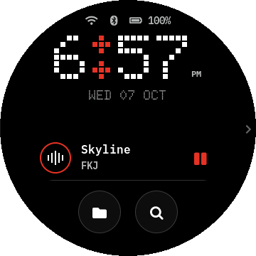 Dot-grid Home</td>
<td align="center" valign="top" width="33%">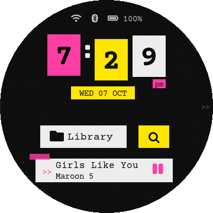 Paper Home</td>
</tr>
</table>

## Network and apps

### Wi-Fi and Bluetooth

On Wi-Fi, use the switch to enable the radio, tap Rescan to refresh the list, tap a network to connect, and enter a password when asked. Tap a connected or saved network for its information and Forget action. Bluetooth offers its own switch and Rescan; tap a found device to pair or connect, and open a paired device's details for Connect when disconnected, Disconnect when connected, Use for audio, Rename or Forget This Device. Details load in the background with Checking or Unknown shown while information is unavailable. Connection failures identify the step that failed. The selected codec depends on what both the firmware and headphones support. Open a paired device's details and tap Rename to give it a nickname on the Disc (Use original name restores it). Nicknames use printable ASCII, up to 32 characters and nine words. Nicknames are stored on the Disc; the remote device's own name is unchanged.

Wi-Fi allows up to 75 seconds for a connection. Network details refresh as it completes; IP and router values appear only when the connection is ready.

### Apps, Last.fm, and weather

Swipe left from Home to Apps, then tap Last.fm, Settings, or an installed external app. An external app takes over the screen and touch input while it runs; its behavior depends on that app. Last.fm setup shows a QR code for entering your own API key and secret on a phone, then a second authorization step; after connection, toggle Scrobbling or tap Disconnect. Failed account or session setting saves are retried. Cast listening can scrobble; AirPlay sending and receiving do not. It is Off until you set it up; the setup page uses plain HTTP on your local Wi-Fi.

With Weather on Home enabled, tap the glance to open Weather. "Weather unavailable" is tappable too, so you can set the location before a reading is available. In Weather, choose a location manually or request automatic location. Weather depends on Wi-Fi and the remote service.

<table>
<tr>
<td align="center" valign="top" width="33%">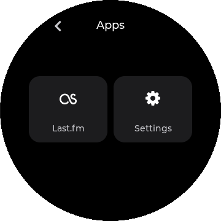 Built-in and external app tiles</td>
<td align="center" valign="top" width="33%">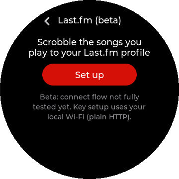 Scrobbling setup</td>
</tr>
</table>

## Updates and safety

### Updates, startup, and power

1.2.1 users can install the signed 1.2.2 app update over Wi-Fi from Settings > System >
Update diskOS if updates are allowed. Fresh installs and older versions use the installer.
The app update replaces only diskOS, not stock firmware or the whole image. It does not
replace the boot install script. The network name hook, the per-flash identity and the
boot-script update-retention fix require a full flash with the complete 1.2.2 installer; see the
[release notes](RELEASE_NOTES_1.2.2.md).
A download shows a progress bar with a percentage and a Cancel button, then Verifying and Saving.
With Automatic Update Checks on, a new release is announced once; downloading still needs your tap.
The release installer includes the diskOS release key by default; untick "Allow diskOS
updates over Wi-Fi" when flashing to omit it.
After restarting into a trial, playback can keep the update automatically. Otherwise, choose
Keep or Go back when asked. An update that fails its startup or health checks rolls back automatically.
Allow diskOS Updates can stop downloads on the Disc. Turning it off with a staged update offers
Discard or Cancel. An install without a key reports that updates are unsupported.

At startup, a light splits into two spectra across the disc, the diskOS wordmark appears
in the hub, and the hub opens to reveal the interface. The animation lasts about 2.4 seconds
and its glow follows the current theme's accent. The wordmark uses Archivo, matching the
website and installer.

The stock player handles the physical power button: one press blanks the display and another restores it. Touch wakes diskOS idle dimming or Screen Off, but a panel put to sleep by the stock player needs the power button. On V2.57, one power-button press also wakes diskOS Screen Off. Button wake restores your diskOS brightness.

When the sleep timer shuts the Disc down, or it powers off after being idle, with the screen on, the screen closes into the disc. A light travels once round the ring while the card is saved safely, and the screen fades to black when done. If saving cannot finish, the screen comes back. The power key is unchanged. The charging icon follows the stock player's charging report and disappears when full; idle power-off does not run while charging, with AirPlay Receiving or Bluetooth Receiving selected, or using USB DAC or USB Storage. These idle holds do not cancel an explicit sleep-timer shutdown.

The physical play/pause button controls playback through the stock player. The Volume Up and Volume Down keys adjust volume by default, or switch tracks according to the V2.57 Vol Keys settings. The separate Screensaver, Screen Off, Sleep Timer, and Idle Power-off choices control later idle behavior. For USB Storage, eject the card safely on the computer before changing modes; diskOS can refuse the switch when card ownership is uncertain.

### Limits

The scanner indexes common music formats and also recognizes AAC, OGG, OPUS, APE, AIFF/AIF, WMA, DSF,
DFF, DTS, external CUE sheets, and SACD ISO tracks; indexing a format does not ensure the stock
player can play it. V2.09 playlist and book playback may fail.

Some mono FLAC, MP3, and Opus files can play slowed down, taking about twice as long
in the stock player. diskOS checks briefly for a missed track advance while the screen
is lit and checks once on wake, but advancing from one mono Opus file to another can
still leave the previous track on screen.

On V2.57, Wi-Fi can still be delayed or turned off after a restart when Bluetooth is saved on.
If Wi-Fi is off, turn it on in Settings > Network > Wi-Fi; if it shows no IP, reconnect there.

Beam: Cast and AirPlay receivers must be on the same Wi-Fi and may not appear on guest networks. Format limits are listed under Beam. Cast control messages are encrypted, but the Disc does not check the receiver's identity. Music and artwork are sent over plain HTTP on your local network. Use a network you trust.
Hebrew letters show in Library and Now Playing; right-to-left ordering is not corrected.

### Safety and stock UI

Settings > Device > Default UI > Stock makes the stock interface the normal boot choice. To use the other interface for one boot, hold Volume Up from power-on until it appears; keep holding long enough for the switch to register. Both choices leave the diskOS image installed. To remove that image, the desktop installer restores a validated saved stock image or rebuilds one using **Get firmware** or **Browse...**. See [restore and recovery](INSTALL.md#restore-stock-and-recover) and [Get firmware](INSTALL.md#get-firmware).
